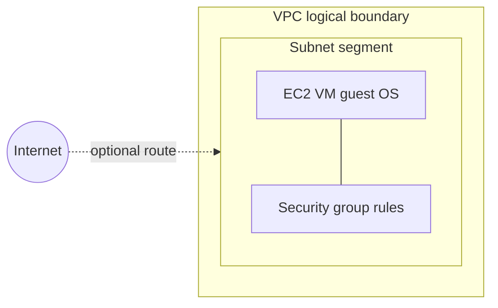

<div class="eli5">
<span class="label">ELI5</span>
<p>ServiceNow already knows <em>what exists</em> in <strong>Amazon Web Services (AWS)</strong>
(the cloud provider) — your virtual machine and networks. <strong>Common Service Data Model
(CSDM)</strong> is the agreed way to add <em>what it is for</em> — for example “Payments (lab)”
— and link that story to real <strong>configuration items (CIs)</strong> in the
<strong>Configuration Management Database (CMDB)</strong>. ServiceNow stores
<strong>descriptions and relationships</strong>; it does not host your app or your data.</p>
</div>

<nav class="toc" aria-label="Lab 7 contents">
  <div>
    <p class="toc-title">On this page</p>
    <ul class="toc-list">
      <li><a href="#hands-on-lab"><strong>Jump to Hands-On Lab →</strong></a></li>
    </ul>
  </div>
  <div>
    <p class="toc-title">Pre-Lab: understand the concepts</p>
    <ul class="toc-list">
      <li><a href="#pre-lab">How to use this page</a></li>
      <li><a href="#pre-lab-cloud">Cloud and AWS</a></li>
      <li><a href="#pre-lab-vpc">VPC and networking</a></li>
      <li><a href="#pre-lab-storage">Compute, disk, databases</a></li>
      <li><a href="#pre-lab-template">Our lab stack (template)</a></li>
      <li><a href="#pre-lab-csdm">What CSDM adds</a></li>
      <li><a href="#pre-lab-csdm-domains">CSDM domains (ELI5)</a></li>
      <li><a href="#pre-lab-workshop-questions">Workshop questions → records</a></li>
      <li><a href="#pre-lab-maturity">What is automatic vs manual</a></li>
      <li><a href="#pre-lab-enterprise-mapping">Enterprise scale (hypothetical)</a></li>
    </ul>
  </div>
  <div>
    <p class="toc-title">Hands-On Lab</p>
    <ul class="toc-list">
      <li><a href="#hands-on-lab">Wizard overview</a></li>
      <li><a href="#hands-on-wizard-vs-classic">Wizard vs classic form</a></li>
      <li><a href="#hands-on-step-1">Step 1 — List and New</a></li>
      <li><a href="#hands-on-wizard-basics">Wizard Basic Details</a></li>
      <li><a href="#hands-on-step-2">Step 2 — Classic form labels</a></li>
      <li><a href="#hands-on-step-3">Step 3 — Choose a Method</a></li>
      <li><a href="#hands-on-step-4">Step 4 — Preview and Done</a></li>
      <li><a href="#hands-on-map">Step 5 — View Map</a></li>
      <li><a href="#hands-on-optional">Optional — script link</a></li>
      <li><a href="#hands-on-checkpoint-a">Checkpoint A (minimal)</a></li>
    </ul>
  </div>
  <div>
    <p class="toc-title">Hands-On: CSDM continuation (Part B)</p>
    <ul class="toc-list">
      <li><a href="#hands-on-part-b">Overview</a></li>
      <li><a href="#csdm-plain-language">Design vs deploy vs offering</a></li>
      <li><a href="#hands-on-outage-example">Outage story (Incident)</a></li>
      <li><a href="#hands-on-incident-fields">Incident form fields</a></li>
      <li><a href="#hands-on-incident-service-reference">Service → cmdb_ci_service (base)</a></li>
      <li><a href="#hands-on-service-field-semantics">used_for vs Environment</a></li>
      <li><a href="#hands-on-incident-unsaved-exercise">Incident walkthrough (no Submit)</a></li>
      <li><a href="#lab7-requirements-audit">Requirements audit matrix</a></li>
      <li><a href="#hands-on-relationship-guide">Relationship guide</a></li>
      <li><a href="#hands-on-how-populated">How relationships get here</a></li>
      <li><a href="#hands-on-records-eli5">Records + navigation</a></li>
      <li><a href="#hands-on-step-6">Steps 6–11 (business stack)</a></li>
      <li><a href="#hands-on-step-12">Step 11 — Capabilities (pending)</a></li>
      <li><a href="#hands-on-views">View Map vs Dependency Views</a></li>
      <li><a href="#hands-on-checkpoint-b">Checkpoint B</a></li>
    </ul>
  </div>
  <div>
    <p class="toc-title">Hands-On: Practice incident (Part C)</p>
    <ul class="toc-list">
      <li><a href="#hands-on-part-c">Purpose and warnings</a></li>
      <li><a href="#hands-on-part-c-nav">Navigation</a></li>
      <li><a href="#hands-on-part-c-scenario">Scenario A / B (CI choice)</a></li>
      <li><a href="#hands-on-part-c-fields">Field-by-field (you create)</a></li>
      <li><a href="#hands-on-part-c-verify">Verify after Submit</a></li>
      <li><a href="#hands-on-part-c-resolve">Resolve / keep for audit</a></li>
      <li><a href="#hands-on-part-c-checkpoint">Checkpoint C</a></li>
      <li><a href="#hands-on-part-c-screenshots">Screenshot inventory</a></li>
    </ul>
  </div>
  <div>
    <p class="toc-title">Lab status and audit</p>
    <ul class="toc-list">
      <li><a href="#lab7-overall-status">Lab 7 overall status</a></li>
      <li><a href="#lab7-requirements-audit">Requirements audit matrix</a></li>
    </ul>
  </div>
  <div class="toc-wide">
    <p class="toc-title">Reference</p>
    <ul class="toc-list">
      <li><a href="#glossary">Glossary (acronyms)</a></li>
      <li><a href="#sources">Sources</a></li>
      <li><a href="#whats-next">What is next (Lab 8)</a></li>
    </ul>
  </div>
</nav>

## Pre-Lab: Understand the concepts
{: #pre-lab}

Use this half **before** you click in ServiceNow. The [Hands-On Lab](#hands-on-lab) is numbered
and separate below.

**Prerequisites:** [Labs 4–6]({{ '/labs/04-run-import/' | relative_url }}) — at least one virtual machine
**configuration item (CI)** on table `cmdb_ci_vm_instance` named `sgclab-app-01`, **virtual private cloud (VPC)** network rows on
`cmdb_ci_network`, subnets and security groups imported. The graph still has **partial** network-interface
and storage edges ([Lab 4]({{ '/labs/04-run-import/' | relative_url }})). Earlier labs used
**Identification and Reconciliation Engine (IRE)** to match inserts/updates and
**Extract, Transform, Load (ETL)** mappings ([Labs 5–6]({{ '/labs/05-ire/' | relative_url }})).

---

### Cloud and Amazon Web Services (AWS)
{: #pre-lab-cloud}

**Amazon Web Services (AWS)** is a provider that runs physical datacenters and sells **access** to
resources in those buildings: virtual computers, networks, storage, databases, and hundreds of
other products. You create an **account**, pay for what you use (often metered by the hour or per
gigabyte), and call **application programming interfaces (APIs)** or a **web console** to create and
change resources. You do **not** own the physical server under your virtual machine.

Companies use AWS (or similar providers) versus **only their own datacenter**, versus
**software as a service (SaaS)** (someone else runs the whole application), for different mixes of:

| Factor | Why it comes up |
|---|---|
| **Elasticity** | Scale up for a sale, scale down overnight — no purchase order for new hardware |
| **Speed** | New environment in minutes instead of weeks of procurement |
| **Skills** | Team already knows AWS, or wants managed services (databases, load balancing) |
| **Data residency / regulation** | Banks and governments pick **regions**, encryption, and hybrid models (some systems stay on-premises) |
| **Operations** | Provider runs building power and the **hypervisor** (software that runs virtual machines); **you** still patch the **guest operating system** and secure the app — **shared responsibility** |
| **Cost** | Cloud is **not** automatically cheaper; idle or oversized resources still bill; stopped **Elastic Compute Cloud (EC2)** instances can still incur **Elastic Block Store (EBS)** disk charges |

**Illustrative patterns (not claims about any named company):**

- **Small product company:** one virtual web server + managed database, one **virtual private cloud
  (VPC)** network, autoscaling later.
- **Bank or regulated enterprise:** hybrid — legacy cores on-premises, cloud for specific workloads,
  heavy identity, logging, and change control; ServiceNow often tracks **what** exists and **what
  depends on what**, not **moves** workloads into ServiceNow.
- **Global technology firm:** many regions, load balancers, autoscaling groups, separate accounts per
  environment — **Configuration Management Database (CMDB)** and **Common Service Data Model (CSDM)**
  help **impact** and **ownership**, not replace architecture reviews.

None of these are “our lab.” The lab is one **stopped** small virtual machine for learning.

---

### Your “private network in AWS” (VPC)
{: #pre-lab-vpc}

A **virtual private cloud (VPC)** is a **logical**, account-local network boundary: address ranges
and routing rules AWS applies inside its fabric. It is **not** extra physical cabling to your office
and **not** automatic secrecy from the **internet**.

| Term | Beginner meaning |
|---|---|
| **VPC** | A private **Internet Protocol (IP)** address plan for your account in one **region** (here: e.g. `us-east-2`). Addresses often use **Classless Inter-Domain Routing (CIDR)** notation like `10.42.0.0/16`. In **this** lab’s CMDB, VPCs appear under table `cmdb_ci_network`, not necessarily `cmdb_ci_vpc`. |
| **Subnet** | A **segment** of that address plan tied to one **availability zone (AZ)** (one datacenter slice in the region). Lab CMDB: table `cmdb_ci_cloud_subnet`. |
| **Route table** | Rules that decide whether traffic can leave the subnet toward the internet or other networks. |
| **Security group** | **Stateful** virtual firewall attached to an instance’s **network interface** (allow/deny ports and sources). Not antivirus. Lab CMDB: table `cmdb_ci_compute_security_group`. |
| **Private IP** | Address used **inside** the VPC. |
| **Public IP** | Optional address reachable from the public internet if routing and firewall allow. **Public subnet** only means “this subnet *can* get a public path” — not every server is public. |
| **Remote login** | **Secure Shell (SSH)** for Linux or **Remote Desktop Protocol (RDP)** for Windows is a session **inside the guest operating system**, separate from the AWS console. Requires a **running** instance, reachable network path, credentials, and (for SSH) usually a key pair. **AWS Systems Manager (SSM)** **Session Manager** is another path — needs agent, **Identity and Access Management (IAM)** permissions, and endpoints; **not assumed** in this lab. |



In the diagram, **EC2** means **Elastic Compute Cloud** — AWS’s rented virtual computer.

**Do not** start the lab instance “to try SSH” unless you accept **cost and security** changes
(extra keys, inbound rules, or public IP). The template is built for **inventory learning**, not
remote administration.

---

### Compute, disk, files, databases — different jobs
{: #pre-lab-storage}

| AWS idea | What it is | In our lab stack? | Typical company use |
|---|---|---|---|
| **EC2** (**Elastic Compute Cloud**) | Rent a virtual computer (guest **operating system**) | **Yes** — one `t3.micro` size | Run app runtimes, batch jobs, middleware |
| **EBS** (**Elastic Block Store**) | Persistent **disk volume** attached to EC2 | **Implicit** with the instance (root volume); connector may show **partial** storage CIs | Keep data when the virtual machine restarts |
| **S3** (**Simple Storage Service**) | **Object** store (files/buckets) | **Not** in our minimal template | Backups, static assets, data lakes |
| **RDS** (**Relational Database Service**) | Managed **database** (provider patches engine) | **Not** in our template | Production apps without running MySQL on EC2 yourself |

ServiceNow imports **descriptions** of these through the **Service Graph Connector** and **AWS
Config** (configuration recorder); it does **not** store application data or run your **Payments**
code.

---

### Exactly what Lab 1 created (template truth)
{: #pre-lab-template}

From [`aws/lab-stack.yaml`](https://github.com/eltonaguiar/ServiceNow_ServiceGraph_Lab/blob/main/aws/lab-stack.yaml) in this repository (**AWS CloudFormation** = infrastructure as code template):

| Resource | Template fact | CMDB relevance |
|---|---|---|
| **VPC** | `10.42.0.0/16`, named `sgclab-vpc` | Table **`cmdb_ci_network`** after import |
| **Subnet** | `10.42.1.0/24`, **no** auto public **IP** | Table **`cmdb_ci_cloud_subnet`** |
| **Security group** | **No inbound rules** | Table **`cmdb_ci_compute_security_group`** |
| **EC2** | **`t3.micro`**, image **Amazon Linux 2023** (**Amazon Machine Image (AMI)** from **AWS Systems Manager (SSM)** public parameter), **Name** tag `sgclab-app-01` | Table **`cmdb_ci_vm_instance`**, state **Off** when stopped |
| **Key pair / SSH** | **Not** defined in template | You cannot assume SSH works without **your** changes |
| **Tags** | `Environment`, `Owner`, `Application` (value `payments`) | Surface on CI or related attributes via connector — **not** the same as a CMDB column named `Application` |

**AWS Config** (Lab 3) was narrowed to **four** resource types: Instance, VPC, Subnet,
SecurityGroup. That matches **partial** network-interface/volume graph gaps in Labs 4–5 — do **not**
widen Config just to “finish” the graph for this course.

**There is no real Payments application installed** — only a label for learning.

---

### What CSDM adds (and what it does not prove)
{: #pre-lab-csdm}

**Common Service Data Model (CSDM)** is ServiceNow’s standard **tables and relationship types** for
linking technical **configuration items (CIs)** to **services** (things the business cares about).

| CSDM helps with | It does **not** automatically prove |
|---|---|
| “What technical items sit under this service?” | That the service would **fail** in production if one VM stops |
| Impact and change scoping questions | That every dependency is discovered |
| Shared vocabulary for Incident, Change, and architecture modules | That **Service Mapping** ran (licence + setup) |

**ServiceNow** holds **metadata**: classes, attributes, relationships, owners. **AWS** still runs
the VM. **This lab** does not move workloads into ServiceNow.

### CSDM domains — ELI5 (version-aware official names)
{: #pre-lab-csdm-domains}

**Common Service Data Model (CSDM) 5** groups CMDB data into **seven domains** (plus shared
**Foundation** data). Names come from ServiceNow’s CSDM framework docs; your Navigator labels may
truncate or differ by release ([Exploring CSDM](https://www.servicenow.com/docs/r/yokohama/servicenow-platform/common-service-data-model-csdm/csdm-content-frame-exploring.html)).

| Domain (official CSDM 5) | ELI5 purpose | Typical personas | Lab 7 touchpoint |
|---|---|---|---|
| **Foundation** | Address book of the enterprise — company, location, groups, contracts. | Admin, HR-adjacent | Imported AWS **datacenter/region** CIs indirectly |
| **Ideation & Strategy** | Ideas and investments before build — goals, demand, portfolio choices. | Portfolio manager, SPM | **Not filled** — optional in real firms |
| **Design & Planning** | **Blueprint** — what we *plan* to own (apps, capabilities, information). | Enterprise architect, app owner | **`Payments`** business application; **capability** pending |
| **Build & Integration** | How software is built, pipelines, integration endpoints. | DevOps, integration | **Out of scope** — no real CI/CD in lab |
| **Service Delivery** | **Running** technology that delivers value — infrastructure, **service instances**, integrations. | Ops, cloud, CMDB | **Connector** imports; **`Payments (lab)`** service instance; **`sgclab-app-01`** |
| **Service Consumption** | **Business-facing** services customers or internal users experience. | Service owner, SPM | **`Payment Processing`** + **Dev offering** |
| **Manage Portfolios** | Cross-domain portfolio governance (spanning products). | Portfolio office | **Mention only** — we use SPM lists, not full governance |

**Release-aware display names (CSDM v5 alignment):** Product documentation re-labels some tables for clarity
— for example **Application Service** / **`cmdb_ci_service_auto`** often appears as **Service Instance** in
current docs, and **Technical service** as **Technology management service**
([Exploring CSDM](https://www.servicenow.com/docs/r/yokohama/servicenow-platform/common-service-data-model-csdm/csdm-content-frame-exploring.html)).
Your PDI may still show older Navigator text.

**Design vs delivery (critical for Incident):** Official **Design** domain guidance states records such as
**business application** and **business capability** support planning; they are **not** the usual direct
targets for **Incident**, **Problem**, and **Change** processes the way operational **service** and
**CI** references are ([Design domain](https://www.servicenow.com/docs/r/yokohama/servicenow-platform/common-service-data-model-csdm/design-domain.html)).
**`Payments`** (business application) is **portfolio software design**, not proof a **deployment** is down.

<details markdown="1">
<summary><strong>Hypothetical enterprise implementation (payments — not mandatory to complete every cell)</strong></summary>

| Real-world question | CSDM / domain lane | Example record (hypothetical) | Owner (typical) | Evidence | Relationship (example) | Validation |
|---|---|---|---|---|---|---|
| What customer outcome broke? | **Service Consumption** | Business service **Payment Processing** | Service owner | SLA/CSAT deck | Offering **Depends on** app service | Owner signs dependency view quarterly |
| Which users / channel? | **Service Consumption** | Offering **Prod** vs **Dev** variants | Product owner | Support matrix | Offering **Parent** → business service | Ticket samples use correct offering |
| What did we promise in support? | **Service Consumption** + process | Offering description, hours, priority | Support lead | Contract excerpt | Links to knowledge articles | Audit random incidents |
| What software is in the portfolio? | **Design & Planning** | **`cmdb_ci_business_app` Payments** | App owner | EA repository | **Consumes** → service instance | EA review — **not** ops uptime proof |
| What runs in Dev vs Prod? | **Service Delivery** | **`Payments-Dev`** / **`Payments-Prod`** instances | Ops | Tag/env conventions | **Manual** or mapped CIs | Map vs CMDB Health |
| Shared platform (DB, network)? | **Service Delivery** | **Technology management service** (not built here) | Platform team | Runbooks | **Depends on** edges | Platform map review |
| What capability does this enable? | **Design & Planning** | **`cmdb_ci_business_capability`** (pending) | Business architect | Capability map | **Provided by::Provides** → business service | DPM workspace check |
| Where does inventory come from? | **Service Delivery** + **Foundation** | AWS connector, Discovery, manual | Cloud admin | Import job history | **`cmdb_rel_ci`** from imports | Reconcile duplicates via **IRE** |
| Who answers the incident? | ITSM process + **Foundation** | Assignment group, support group on CI | Service desk lead | Routing table | **Optional** rules on **cmdb_ci** | Tabletop — **no** auto guarantee |

You **do not** need every row populated on a PDI. This lab intentionally stops with a **thin** slice:
connector inventory + one **service instance** + one **business service** stack + **no** capability.

</details>

### Question-led setup (interview / workshop method)
{: #pre-lab-workshop-questions}

Use questions in order — skip sections your organization has not prioritized.

1. **Customer / outcome:** “If checkout failed, what would executives *name* as broken?” → the **business-facing name** you store for **Service Consumption** (here **`Payment Processing`**). On **Incident**, the **Service** column **`business_service`** references the **base** table **`cmdb_ci_service`**, which can include **multiple service subclasses** depending on **reference qualifiers** — not only **`cmdb_ci_service_business`**.
2. **Variation:** “Retail vs mobile vs internal Dev?” → **service offerings** (`service_offering`) — our **Payment Processing — Development** is one flavor, not a universal naming scheme.
3. **Deployment:** “Which *running stack* maps to that offering?” → **service instance** (`cmdb_ci_service_discovered` / **`Payments (lab)`**).
4. **Gear:** “Which server or cloud object is suspect?” → **configuration item** (`cmdb_ci_*` — e.g. **`sgclab-app-01`**).
5. **Portfolio software:** “Which product in the catalog is related?” → **business application** — design only; link via **Consumes::Consumed by**, **not** as substitute for **CI**.
6. **Capability:** “Which business ability does this support?” → **business capability** — relationship **Provided by::Provides** (Step 11 pending).
7. **Shared tech:** “Who owns the shared database cluster?” → **technology management service** — documented, **not** created in this lab.
8. **Proof:** “What import or scan created this CI?” → connector / Discovery evidence + **IRE** — validate before trusting impact.
9. **Incident drill:** “What would agents type on a **new** incident?” → [Incident walkthrough](#hands-on-incident-unsaved-exercise) — **do not Submit**.

**Manual vs automatic (methodology):** Start **manual** on one pilot (this lab), define **owners** and
**validation**, then layer **connector**, **Discovery**, and **Service Mapping** only where licence,
credentials, and network path exist ([application services](https://www.servicenow.com/docs/r/servicenow-platform/configuration-management-database-cmdb/application-services.html)).

---

### What is automatic vs manual (maturity)
{: #pre-lab-maturity}

| Layer | Who fills it in this lab |
|---|---|
| EC2, VPC, subnet, security group | **Service Graph Connector** + **IRE** ([Labs 2–6]({{ '/labs/04-run-import/' | relative_url }})) |
| “This grouping is **Payments (lab)**” | **Human** ([Hands-On Lab](#hands-on-lab)) |
| Full automated dependency map | **Service Mapping** (optional product; **not** required here) |

### Enterprise scale: manual vs automated mapping (hypothetical)
{: #pre-lab-enterprise-mapping}

<details markdown="1">
<summary><strong>How larger organizations usually set up Service Mapping and CSDM — and why this lab is only manual</strong></summary>

**This lab** uses **Manual** wizard population to **`sgclab-app-01`** on a **stopped** VM with **no**
payment software installed. That is **learning metadata**, **not** automated discovery of a running
Payments stack. Product docs warn that manual maps **do not automatically follow** relationship changes
([application services](https://www.servicenow.com/docs/r/servicenow-platform/configuration-management-database-cmdb/application-services.html)).

#### Hypothetical payments company (not a real customer story)

Imagine a bank that runs **Payments** in **separate Dev and Prod** application services (different
**Environment** values, different entry points). Business owners maintain **`cmdb_ci_business_app`**
and **`cmdb_ci_business_capability`** records; operators run **`Payments-Prod`** and **`Payments-Dev`**
service instances. **Business service offerings** (customer language) and **technical management service
offerings** (shared database/platform teams) can both exist — this lab modeled **business** offerings
only; we did **not** create **technical management service** rows.

Naming like **`Payments (lab)`** or **`Payment Processing — Development`** is **our teaching pattern**,
not a universal enterprise standard.

#### Typical enterprise phases (simplified)

1. **Portfolio / design** — business applications, capabilities, owners ([CI relationships](https://www.servicenow.com/docs/r/servicenow-platform/common-service-data-model-csdm/ci-relationships.html)).
2. **Conventions** — environment tags, ownership, region, **Identity and Access Management (IAM)** boundaries.
3. **Inventory** — **Service Graph Connector** / cloud APIs, **Discovery**, **AWS Config** (each needs its own
   credentials and scope — **not** one shared credential for everything).
4. **Service Mapping** (if licensed) — **Top-down** (patterns + credentials into guest OS), **tag-based**
   (complements top-down; does not draw all connections alone), **manual**, **dynamic CI group**, per
   [application services](https://www.servicenow.com/docs/r/servicenow-platform/configuration-management-database-cmdb/application-services.html).
5. **Identification and Reconciliation Engine (IRE)** — authoritative merge rules; duplicates break trust.
6. **Pilot** — one production-like service; owners **validate** maps; change process when topology drifts.
7. **Scale** — phased onboarding, **CMDB Health**, access reviews, network/firewall paths for Discovery MID
   servers or cloud APIs.

#### Inventory connector vs Discovery vs Service Mapping (different doors)

| Entry path | What it usually brings | Credentials / licensing (varies by release) |
|---|---|---|
| **Service Graph Connector** (this course) | Cloud **inventory** CIs and relationships from vendor APIs | Cloud **IAM** role/user scoped to inventory; **IRE** on the instance |
| **Discovery** (horizontal scan) | Live IP ranges, MID Server reachability, software on hosts | MID Server + SNMP/SSH/WinRM as configured; **not** the same IAM as AWS connector |
| **Service Mapping** (application map) | **Top-down** or **tag** population of **application services** | **`service_mapping_admin`** / **`sm_admin`**, pattern credentials into apps, often **ITOM** entitlement |
| **Wizard Manual** (this lab) | You choose CIs; map stays until someone edits it | **`app_service_admin`**; **no** Service Mapping licence required for this method |

Do **not** assume one AWS key or one MID configuration covers every row.

#### Refresh, stale maps, access, and network

- **Connectors** refresh on schedules you configure; **stale** rows still happen when cloud changes outpace imports or IRE rejects updates.
- **Manual** application services **do not** add CIs when new VMs appear — someone must edit membership or adopt **Dynamic CI Groups** / **Dynamic Service** rules ([Create a Service instance](https://www.servicenow.com/docs/r/servicenow-platform/configuration-management-database-cmdb/create-it-services.html)).
- **Top-down Service Mapping** needs **network path** from MID or credentials to guest processes — firewalls and least-privilege accounts are explicit design work.
- **Access:** cloud inventory roles, Discovery credentials, and Service Mapping pattern logins are **separate** security reviews — enterprise teams keep an **accountable service owner** who signs off on map accuracy, not only on connector green checks.

#### Support and process integration

Larger shops tie **map validation** to **Change** or **release** records, run periodic **CMDB Health** dashboards, and teach service owners to open **Dependency Views** before major cutovers. **Incident** and **Event Management** may use relationship data **only** when products, rules, and data quality are in place — a pretty graph in training is not production impact automation.

#### Responsibility matrix (capabilities, not promises)

| Activity | Often automatic | Often manual / hybrid | Limitations |
|---|---|---|---|
| Cloud VM/VPC inventory | Connector, Config | CSV/fix scripts | Partial graphs (this lab’s NIC/storage gaps) |
| Installed software on host | Discovery / patterns | Owner attestations | Needs reachability + credentials for top-down |
| Application service **membership** | Service Mapping, tags | Wizard **Manual**, dynamic groups | Manual maps drift; tag maps miss untagged CIs |
| **Business application** ↔ **application service** | Imports, EA tools | Wizard **Set Relationships** | Wrong relationship **type** breaks downstream products |
| **Business capability** ↔ **service** | DPM / imports | **`cmdb_rel_ci`** with **Provided by::Provides** | Capability record must exist as **Parent** ([DPM](https://www.servicenow.com/docs/r/it-service-management/digital-portfolio-management/dpm-business-capability.html)) |
| Incident “what broke?” | Event rules **if configured** | Analyst walk of relationships | **No** automatic guarantee without supported rules + accurate CI data |

#### Three relationship ideas beginners confuse

| Idea | Example edge | What it is **not** |
|---|---|---|
| **Inventory / hosting** | VM in AWS account; connector insert | Proof the app process is running |
| **Application dependency** | **Depends on::Used by** toward DB/load balancer | Same as business **Consumes** toward portfolio app |
| **Business portfolio** | **Consumes::Consumed by** / **Uses::Used by** business app → app service | Automatic outage dollars or PCI scope |

#### Business vs technical offerings (even if you only built business)

| | **Business service offering** | **Technical management service offering** |
|---|---|---|
| **Audience** | Business / customer language | Platform / ops teams (databases, networks) |
| **Table** | **`service_offering`** (classification **Business Service**) | **`service_offering`** (classification **Technical Service**) |
| **This lab** | **Payment Processing — Development** | **Not created** — document only |

#### Stale data and impact

Manual and hybrid maps go **stale** when engineers change cloud resources without updating ServiceNow.
**Event Management** / **Incident** impact views need **configured** rules and trustworthy edges — our
**Traffic based discovery** property = **Enabled** does **not** prove discovery ran.

</details>

**Your concise takeaway:** Use this lab to **name** and **relate** records honestly; use enterprise
automation only with **licensed** products, **credentials**, **owners**, and **validation** — not by
assuming the connector lab equals Service Mapping.

---

## Hands-On Lab
{: #hands-on-lab}

**Part A (minimal):** Create a manual **application service** and **View Map** entry point — Steps 1–5
and [Checkpoint A](#hands-on-checkpoint-a).

**Part B (broader CSDM):** Add a **business application** design record and supported relationships —
[continuation](#hands-on-part-b). **Lab 7 is not complete** until you decide how far to take Part B; Part A
alone is a deliberate **limited** stop.

**Goal (Part A):** Start an **application service** in the official wizard and use **Manual**
population toward your lab virtual machine — **without** claiming a finished production graph.

**You need:** A **Personal Developer Instance (PDI)** (or similar) with CMDB data from Labs 4–6.
Confirm role **`app_service_admin`** (application service administrator) per ServiceNow docs —
entitlements vary by instance.

**Official references (field names differ by release):**

- [Create a Service instance (application service)](https://www.servicenow.com/docs/r/servicenow-platform/configuration-management-database-cmdb/create-it-services.html)
- [Manual population method](https://www.servicenow.com/docs/r/zurich/servicenow-platform/configuration-management-database-cmdb/populate-app-service-manual.html)
- [Amazon VPC overview](https://docs.aws.amazon.com/vpc/latest/userguide/what-is-amazon-vpc.html) (AWS)

Use ServiceNow’s documented flow — do **not** invent a second “service instance” child record
under the application service. The application service on table **`cmdb_ci_service_auto`** **is** the
service instance record for this workflow. Manual population stores the record under a subclass such
as **`cmdb_ci_service_discovered`** on many releases — that is **not** proof that **Service Mapping**
ran or that dependencies are complete.

### Wizard vs classic form (read first)
{: #hands-on-wizard-vs-classic}

ServiceNow documents an **Application Service wizard** with three stages —
**Provide Basic Details** → **Populate the Application Service** → **Preview the Service** ([Create a Service instance](https://www.servicenow.com/docs/r/servicenow-platform/configuration-management-database-cmdb/create-it-services.html)).
Community guidance describes that wizard as a separate UI (often referenced in URLs containing
`csdm_app_service`) from the **classic Service Instance form** on `cmdb_ci_service_auto` — field
labels differ between them.

| You are in the **wizard** if… | You are in the **classic form** if… |
|---|---|
| Title such as **Create an Application Service** / **New Application Service** | One scrolling form (often **Service Instance** header) |
| Stages **Provide Basic Details** → **Populate the Application Service** → **Preview the Service** | No population stage — **Submit** / **Save** on one form |
| Basic Details field label **Environment** (distinct from **Used for**) | **Used for**, **Comments**, **Business criticality**, **Service classification** |
| **Next** moves toward population / **Choose a Method** | List **New** may be a single button with **no** dropdown (observed on one classic path) |

**Do not conflate labels:** On the wizard, **Environment** is its own field (one PDI showed default
**None**). On the classic form, **Used for** = `Development` is a **different** label — do **not** type
`Development` into **Environment** on the wizard unless that field’s choice list offers it, and do
**not** rename wizard **Environment** to **Used for** in your notes.

**Navigator search:** Typing **service instance** can show **more than one** module, for example:

- **Configuration** → **Service Instances** → **Service Instances**
- **CSDM** → **Manage Technology Manage…** (label may truncate in search) → **Service Instance**

This lab does **not** assert which of those entries opened the wizard vs the classic form until **you**
confirm which path you used. The official written procedure uses the **CSDM** branch ([Create a Service instance](https://www.servicenow.com/docs/r/servicenow-platform/configuration-management-database-cmdb/create-it-services.html)); your instance may also expose **Configuration** lists. Filter Navigator jumps straight to `cmdb_ci_service_auto.list` can still open the **classic** form on some PDIs.

Role **`app_service_admin`** is required for manual population ([manual populate doc](https://www.servicenow.com/docs/r/zurich/servicenow-platform/configuration-management-database-cmdb/populate-app-service-manual.html)); without it you may see a reduced UI. This lab does **not** invent direct URLs or deep links.

### Step 1 — Open the wizard or classic list
{: #hands-on-step-1}

1. Use **Navigator search** or menus to open a **Service Instances** list (see dual entries above).
   Note which path you chose so you can compare wizard vs classic behavior.
2. On the list, click **New** (on one classic path this was a **lone** button with **no** menu dropdown).
3. **If the Application Service wizard opens**, you should see:
   - Title **Create an Application Service** or **New Application Service** (wording varies by release)
   - Stages **Provide Basic Details** → **Populate the Application Service** → **Preview the Service**

**If you get the classic form instead:**

1. **Do not Submit** yet — note field labels (**Used for**, not **Environment**).
2. Try the **other** Service Instances module from Navigator search, then **New** again.
3. Confirm **`app_service_admin`**. Entitlements change available **New** actions.

**Neither route submitted yet?** That is fine for learning — this lab does not require a saved record to
read the pre-lab material. For instructor review, capture the **full list** (title + **New** control) and
note which navigator entry you used. We do **not** embed screenshots on the site.

### Step 1b — When you have the wizard (Basic Details)
{: #hands-on-wizard-basics}

On **Provide Basic Details**, match **wizard** labels only (verified on one PDI — defaults may differ):

| Wizard field (on screen) | What to enter for this lab |
|---|---|
| **Number** | Leave auto-generated |
| **Name** | `Payments (lab)` |
| **Environment** | Choose **Development** **if** it appears in the list (default observed: **None** — change only when offered) |
| **Operational status** | Keep **Non-Operational** for a learning record |
| Other fields on the same tab | Scroll and review; fill only what your instance marks required |

Then select **Next** toward **Populate the Application Service**. Do **not** claim **Done** or a saved
graph until you finish population and save.

### Step 2 — Classic form only (if you are not in the wizard)
{: #hands-on-step-2}

Learning example only — **not** production Payments. **Do not** claim the record is submitted or the
graph complete until you save and can verify relationships yourself.

**Wizard** — use Step 1b when you are on **Create an Application Service**; the on-screen label is
**Environment**, not **Used for** ([Create a Service instance](https://www.servicenow.com/docs/r/servicenow-platform/configuration-management-database-cmdb/create-it-services.html)).

**Classic Service Instance form** — separate route; labels observed when **New** opened the classic UI
(textual evidence only; not submitted on that path in this investigation):

| Classic field label | Example for this lab |
|---|---|
| **Name** | `Payments (lab)` |
| **Used for** | `Development` |
| **Business criticality** | `4 - not critical` (or your instance’s wording) |
| **Operational status** | `Non-Operational` |
| **Service classification** | `Application Service` |
| **Comments** | `learning example` |

**Environment** (wizard) and **Used for** (classic) are **different fields on different screens** — not
two names for the same wizard control. Match the **labels on your current screen**.

Set **relationships** only as your release requires. CSDM relationship names are **typed** — e.g.
**Depends on** / **Used by** in manual population docs. Do **not** treat **Hosted on** and **Runs
on** as interchangeable without checking **CI Relationship Types**. Creating relationships on the
form does **not** by itself prove **Service Mapping** or full service-map population.

**Expected:** You can advance to **Populate** (wizard) or save a draft classic record without
claiming the lab checkpoint is done.

### Step 3 — Populate the Application Service (Choose a Method)
{: #hands-on-step-3}

On **Populate the Application Service**, open **Choose a Method** (or **Next** to that modal). You
have **not** chosen a method yet until you pick one from **Service Population Method** and continue.

A **configuration item (CI)** is one tracked thing in the **Configuration Management Database (CMDB)**
(for example your lab virtual machine). Population methods decide **which CIs become members** of the
application service — not whether a real **Payments** application is installed in AWS.

#### Service population methods (this wizard screen)

Wording below matches the **Choose a Method** modal on one PDI (November 2026) plus
[Create a Service instance](https://www.servicenow.com/docs/r/servicenow-platform/configuration-management-database-cmdb/create-it-services.html).
**Roles** come from that page; your instance may differ.

| Method (UI label) | What it means in everyday terms | Prerequisites / notes (product + screenshot) |
|---|---|---|
| **Top-Down Discovery** | Let **Service Mapping** walk connections from an entry point and build the map. | UI: “Use CI connections to map the application service.” Requires **Service Mapping**, role **`service_mapping_admin`**, and a **leaf** domain. Doc role: **`sm_admin`**. Not this lab’s minimum path. |
| **Dynamic CI Groups** | Fill the service from an existing **CMDB group** (a saved group of CIs). | UI: “Use CMDB groups to populate the application service.” Doc: [Dynamic CI Group](https://www.servicenow.com/docs/r/servicenow-platform/configuration-management-database-cmdb/create-it-services.html) method. Role **`app_service_admin`**. You must already maintain CMDB groups — not required for our one-VM lab. |
| **Tags** | Populate from tag lists or tag families on CIs. | UI: requires **Service Mapping** and **`service_mapping_admin`**. Doc role: **`sm_admin`**. Lab AWS **tags** are not the same as picking this wizard method (see tag note below). |
| **Manual** | You pick specific CIs (for example `sgclab-app-01`) by class and name. | UI: “Manually select CIs to create a service.” Doc: [Manual method](https://www.servicenow.com/docs/r/zurich/servicenow-platform/configuration-management-database-cmdb/populate-app-service-manual.html). Role **`app_service_admin`**. **Simplest for this lab** — no Service Mapping entitlement required. |
| **Dynamic Service** | Service membership **updates when CI relationships change** (per wizard text). | UI: “Create App Service and dynamically update based on CI relationship changes.” Doc lists a separate **Dynamic Service** population method ([Create a Service instance](https://www.servicenow.com/docs/r/servicenow-platform/configuration-management-database-cmdb/create-it-services.html)); role **`app_service_admin`**. **Not** the same as **Dynamic CI Groups** (groups vs relationship-driven updates). This lab does **not** configure Dynamic Service rules. |

**Dynamic CI Groups vs Dynamic Service (short distinction):** **Dynamic CI Groups** attach the service
to a **CMDB group** membership set. **Dynamic Service** (product + UI) is a **relationship-driven**
population style — exact rules are product-defined; we only document what the wizard states, not
custom mechanics.


*Screenshot: wizard progress on **Populate the Application Service**; dropdown shows the first methods
(through **Manual**). No account identifiers visible — crop reviewed before commit.*


*Screenshot: same modal scrolled — **Manual** and **Dynamic Service** descriptions. UI options are
grounded in these captures.*

#### Step 3b — Select **Manual** and save (observed on one PDI)

1. In **Service Population Method**, choose **Manual**, then continue.
2. On the Manual screen (per [Manual method](https://www.servicenow.com/docs/r/zurich/servicenow-platform/configuration-management-database-cmdb/populate-app-service-manual.html)), one run showed:

| Field | Observed value |
|---|---|
| **CMDB Table** | Read-only **`cmdb_ci_service_discovered`** |
| **Class** | **Virtual Machine Instance** [`cmdb_ci_vm_instance`] |
| **CI** | **`sgclab-app-01`** |
| **Comments** | (left blank) |

3. Click **Save**. **Expected:** a green confirmation such as **method added successfully**, and a card
   showing **Manual** / **`sgclab-app-01`**.

**Screenshots:** The **Choose a Method** dropdown is captured above. Intermediate Save / green-toast
screens were **not** available for this publish batch — follow the field table; do not assume missing
images failed on your instance.

**Tag note:** AWS tag `Application=payments` is **cloud metadata**. It is **not** automatically a
filter field named `Application` on `cmdb_ci_vm_instance`. The wizard **Tags** population method
requires **Service Mapping** — **not** this minimum path.

**Expected:** Manual selection plus CI pick — **not** proof of a complete service map, **Service Mapping**
run, or a production **Payments** workload.

### Step 4 — Preview and **Done**
{: #hands-on-step-4}

1. Click **Next** to **Preview the Service**.


*Screenshot: wizard progress on **Preview the Service**; the canvas shows the linked CI and properties panel. No account identifiers visible — crop reviewed before commit.*

**Observed on one PDI after Manual save (your preview may differ before save):**

| Preview section | Observed |
|---|---|
| **Relationships** | **No records** (optional **Set Relationships** panes — business application, technical offering, business offering, parent application service — were left empty on purpose) |
| **Population Methods Summary** | **Manual** with **`sgclab-app-01`** |

Empty **Relationships** on Preview is **normal** when you skipped optional CSDM relationship panes in Basic
Details — it is **not** the same as the saved **View Map** entry-point drawing.

2. Click **Done**. **Expected:** success text such as **Application service successfully created** for
   **`Payments (lab)`**, **Environment** **Development**, **Operational status** **Non-Operational**.

**What this still does not prove:**

- No running **Payments** software in AWS.
- No **`cmdb_rel_ci` Depends on** edges or full connector partials (NIC/storage) resolved.
- No **Service Mapping** discovery run.
- **Traffic based discovery** = **Enabled** on the service record is a **property value** — not proof
  discovery executed or that the map is complete.

### Optional — Link a CI with a script (advanced)
{: #hands-on-optional}

On your own PDI only, [`scripts/link_ci.py`](https://github.com/eltonaguiar/ServiceNow_ServiceGraph_Lab/blob/main/scripts/link_ci.py) can create relationships. The **parent** must be the
**application service** you created (`cmdb_ci_service_auto` or discovered subclass), **not** table
`cmdb_ci_service_instance` as a separate child.

```bash
python3 scripts/link_ci.py --list-types
```

Pick a relationship type your instance allows for **Manual** population — align with CSDM, not
assumed **Hosted on** labels.

### Step 5 — View Map (checkpoint map)
{: #hands-on-map}

After **Done**, open **View Map** (from the service or wizard result).

**Observed on one PDI:**

- Map: entry-point arrow to a single **`sgclab-app-01`** node (virtual machine icon).
- **Application Service** properties: **Name** **`Payments (lab)`**, **Entry Points** **`sgclab-app-01`**,
  **Operational status** **Non-Operational**, short description noting a learning example with **no
  payment software installed**.

That verifies a **saved manual application service** with an **entry-point CI** on the map — **not** a complete dependency graph, **not** production Payments, and **not** automatic proof of outage impact.


*Screenshot: map canvas and Application Service properties (created-by metadata bands redacted). Your
timeline dates may differ.*

#### Screenshot inventory (Lab 7 hands-on)

| Step | Status |
|---|---|
| **Choose a Method** dropdown (top + scrolled) | Published (`choose-method-dropdown-*.png`) |
| Manual **Save** / green toast / method card | **Missing** this batch — use Step 3b text |
| **Preview** Relationships vs Population summary | **Missing** this batch — use Step 4 table |
| **View Map** | Published (`payments-lab-view-map.png`) |
| **Payment Processing** + empty **Business Capabilities** | Published (`payment-processing-empty-business-capabilities.png`) |
| **Unsaved** capability **CI Relationship** trap | Published (`capability-ci-relationship-trap-unsaved.png`) |

---

### Checkpoint A — minimal application service (limited stop)
{: #hands-on-checkpoint-a}

<ul class="check">
<li>You can explain <b>VPC</b> vs subnet vs security group without calling the VPC “physical private cabling”</li>
<li>You know our VM is <b>Amazon Linux 2023</b>, <b>stopped</b>, and the template does <b>not</b> promise <b>SSH</b></li>
<li>You completed the wizard with <b>Environment</b> <b>Development</b> (when offered), <b>Manual</b> population to <code>sgclab-app-01</code> on <code>cmdb_ci_service_discovered</code>, and optional relationship panes empty if you had nothing to link</li>
<li>You can explain <b>Preview → Relationships: no records</b> vs <b>View Map</b> still showing an entry-point arrow — observational on one PDI, not a universal guarantee before save</li>
<li><b>View Map</b> shows <code>sgclab-app-01</code> as an entry point — <b>Dependency Views</b> may later show more <code>cmdb_rel_ci</code> edges after Part B; still no <b>Service Mapping</b>, real Payments software, or discovery proof</li>
</ul>

<p><strong>Checkpoint A is complete</strong> when the bullets above match your work. You may pause here;
[Part B](#hands-on-part-b) is the fuller CSDM track on the same page.</p>

---

## Hands-On Part B — CSDM continuation (after Checkpoint A)
{: #hands-on-part-b}

Continue after **`Payments (lab)`** (`cmdb_ci_service_discovered`, **Environment** **Development**,
**Non-Operational**, **View Map** entry **`sgclab-app-01`**). Part B adds **portfolio / service**
records and **`cmdb_rel_ci`** links. **No AWS changes.** **No** real payment processing.

### Design vs deploy vs offering (everyday words)
{: #csdm-plain-language}

| Idea | Table / class (typical) | Everyday meaning |
|---|---|---|
| **Business application** | **`cmdb_ci_business_app`** | **Portfolio / design:** “We have a Payments product in our catalog.” |
| **Application service** | **`cmdb_ci_service_discovered`** | **Deployed stack instance:** “This Dev copy runs on `sgclab-app-01`.” |
| **Business service** | **`service_offering`** root / portfolio service row | **What the business experiences:** “Payment Processing” as a customer-facing service name. |
| **Business service offering** | **`service_offering`** (classification **Business Service**) | **Packaged variant:** e.g. “Payment Processing — Development”. |
| **Configuration item (CI)** | many `cmdb_ci_*` | **A thing in the CMDB** — VM, datacenter, manual endpoint, etc. |

### Payment outage story (for **Incident Management**)
{: #hands-on-outage-example}

Imagine a caller says: *“Customers cannot pay online.”*

| Layer | Record in this lab | What Incident cares about |
|---|---|---|
| **Business service** | **Payment Processing** | **`incident.business_service`** (→ **`cmdb_ci_service`** base) — best **semantic** “what broke for the customer?” row when qualifiers allow |
| **Business service offering** | **Payment Processing — Development** | **Which flavor** (here: internal Dev; not production). |
| **Application service** | **Payments (lab)** | **Technical deployment** operators check — maps to CIs. |
| **Configuration items** | **`sgclab-app-01`**, AWS datacenter CI, etc. | **Concrete gear** — stopped VM, network, region. |
| **Business application** | **Payments** | **Design / portfolio** context — *not* proof the VM is running payment code. |

**Technical management service** (separate CSDM lane) would describe shared infrastructure teams run; this lab
does **not** model a full technical-management stack. **Service Mapping** discovery is **not** proven here.

Relating records helps analysts **walk the chain** offering → application service → VM; it does **not**
automatically compute revenue impact or prove PCI scope.

#### Incident form fields (typical — verify your PDI)
{: #hands-on-incident-fields}

**Incident** extends **Task** on table **`incident`**. ServiceNow community CSDM–Incident alignment material
maps CMDB references on the form to columns below (display labels vary by release and **Form Design**;
confirm on **Incident → Personalize form** or **sys_dictionary** for table **`incident`**).

| UI label often seen (unsaved **New** incident) | Column (typical) | Reference table | Qualifier / caveat |
|---|---|---|---|
| **Caller** (mandatory) | **`caller_id`** | **`sys_user`** | Person reporting — required OOB on many forms. |
| **Short description** (mandatory) | **`short_description`** | (text) | One-line summary — required OOB. |
| **Service** | **`business_service`** | **Base** **`cmdb_ci_service`** | Column name is historical; UI may still say **Service** or **Business service**. Reference is the **parent service table**, not **`cmdb_ci_business_app`**. See [Service reference proof](#hands-on-incident-service-reference). |
| **Service offering** | **`service_offering`** | **`service_offering`** | Often filtered to offerings whose **Parent** matches **Service** — admins may add **reference qualifiers** and client scripts ([leading-practice community guide](https://www.servicenow.com/community/s/cgfwn76974/attachments/cgfwn76974/it-service-management-kb/1768/2/How%20to%20configure%20incident%20management%20to%20align%20with%20CSDM%20leading%20practice%20v3.pdf)). |
| **Configuration item** | **`cmdb_ci`** | **`cmdb_ci`** | May restrict allowed **classes** (server, network gear, **application service** subclasses, etc.) — **your** qualifier decides whether **`Payments (lab)`** or only infrastructure CIs appear. |

**Related lists (not on every form layout):** CSDM incident use cases also mention **`task_ci`** (affected /
causal CIs) and **`task_cmdb_ci_service`** (impacted services). **Do not assume** your PDI shows them without
personalizing the form ([Incident with CSDM 2.1 community PDF](https://www.servicenow.com/community/s/cgfwn76974/attachments/cgfwn76974/common-service-data-model-forum/2774/4/Incident%20Use%20Case%20for%20CSDM%202.1%20(002).pdf)).

| Indirect graph (usually **not** the three reference fields above) | Table (typical) | How analysts might use it |
|---|---|---|
| **Business application** | **`cmdb_ci_business_app`** | Portfolio context via **CMDB** / **CSDM** workspace — **not** deployment status. |
| **Business capability** | **`cmdb_ci_business_capability`** | Strategy map — **we did not create** one in this lab. |
| **Technology management service** | **`cmdb_ci_service_technical`** | Shared platform ownership — **not** modeled here. |

**Direct vs indirect:** **`business_service`**, **`service_offering`**, and **`cmdb_ci`** are **direct**
incident references when present on the form. **Business application**, **capability**, and **technical
management service** are usually **indirect** — reachable through **relationships**, reports, or optional
custom fields, not a substitute for picking the operational **Service** / **CI** correctly.

**No guaranteed automation:** OOB does **not** promise autofill from **`sgclab-app-01`**, **View Map**, or
**Dependency Views** into **assignment group**, **priority**, **impact**, or impacted-service related lists.
Those need **workflow**, **client scripts**, **Event Management**, or manual discipline.

#### Incident `business_service` → base `cmdb_ci_service` (verified lookup pattern)
{: #hands-on-incident-service-reference}

On an unsaved **Incident**, open the **Service** reference picker (magnifying glass). One verified PDI builds a list URL like:

`/cmdb_ci_service_list.do?sysparm_target=incident.business_service&sysparm_element=business_service&sysparm_reference=cmdb_ci_service&sysparm_view=sys_ref_list&sysparm_additional_qual=`

| URL / metadata clue | What it means | What **not** to conclude |
|---|---|---|
| **`sysparm_reference=cmdb_ci_service`** | The field points at the **base** **Service** table, so **any eligible subclass row** may appear (business, application/service instance, technical, legacy rows still on the base class). | **Never** teach that only **Business Service** rows are selectable. |
| **`sysparm_additional_qual` empty in the URL** | No *extra* qualifier was appended to this lookup request. | **Not** proof that **zero** filtering applies — **dictionary** entries, **dictionary overrides** on table **`incident`**, **dynamic reference qualifiers** (script), and **client scripts** can still limit classes. |
| Dedicated class **`cmdb_ci_service_business`** (when used) | Narrower than the **base** table — common after business-service table split / migration. | Do not equate “business service” English wording with “only this subclass in the picker.” |
| **`cmdb_ci_service_discovered`** / **Service Instance** rows | **Service Delivery** deployments such as **`Payments (lab)`**. | May or may not appear in **Service** pickers — depends on **your** qualifiers, not lab prose. |

**Teach two layers:**

1. **Semantic best match (storytelling):** For *“customers cannot pay”* language, prefer the **Service Consumption** name **`Payment Processing`** and matching offering **`Payment Processing — Development`** when those records exist and match the narrative — even if your **`cmdb_ci`** field points at **`sgclab-app-01`** or **`Payments (lab)`** for the technical layer.
2. **Allowed classes (instance truth):** Only rows that pass **reference qualifiers** on **`incident.business_service`** are selectable. Right-click **Service** → **Configure dictionary** (or **System Definition → Dictionary**, element **`business_service`**, with **incident** override) to see **Reference**, **Reference qualifier**, and **Use reference qualifier** settings. Community examples filter to `sys_class_name=cmdb_ci_service_discovered` on some instances ([ITS forum thread](https://www.servicenow.com/community/itsm-forum/update-service-field-on-incident-form/td-p/672618)); others target **`cmdb_ci_business_service`** after migration ([CMDB blog](https://www.servicenow.com/community/cmdb-blog/migrating-business-services-from-base-cmdb-ci-service-to/ba-p/3266036)).

**Repo honesty:** No incident list screenshot is published yet (transfer failed earlier). Verify pick-list contents on **your** PDI; do not treat this page as a screenshot of allowed rows.

##### Sanitized Service list export (t562 — lab-relevant rows only)

A **list export** from the **`cmdb_ci_service`** family was reviewed on the author’s PDI (**CSV attachment could not be published** to this repo). Treat it as **most likely** representative of rows that appeared in a **Service** lookup context at export time — **not** proof of an exhaustive incident picker, and **not** every row on the instance (other names were omitted here; many had **blank** **service classification**).

| **name** (sanitized) | **used_for** | **service_classification** | **operational_status** |
|---|---|---|---|
| Payment Processing | Production | Business Service | Operational |
| Payment Processing — Development | Production | Business Service | Operational |
| Payments (lab) | Production | Application Service | Non-Operational |
| ServiceNow Event Management | Production | Application Service | Operational |

**How to read this export:**

| Point | Meaning |
|---|---|
| **No `sys_class_name` column** in this export | **`service_classification`** (Business / Application / Technical, etc.) is a **field value**, not a guaranteed map to CMDB **class**. Do not treat classification alone as proof of subclass. |
| **Mixed classifications in one list** | Together with **`sysparm_reference=cmdb_ci_service`**, this supports **broader** incident **Service** candidates than “business services only” — e.g. **`Payments (lab)`** (Application Service) beside **`Payment Processing`** (Business Service). |
| **`used_for` = Production** on **`Payments (lab)`** | **Distinct** from wizard **Environment** = **Development** on the same record in Lab 7 hands-on. These are **different attributes/labels** on different forms — **do not silently conflate** or “fix” one to match the other without checking **dictionary mapping**, choice lists, and which form you used ([Create a Service instance](https://www.servicenow.com/docs/r/servicenow-platform/configuration-management-database-cmdb/create-it-services.html)). |
| **`operational_status`** on service CIs | CMDB/service lifecycle signal (here **Non-Operational** on **`Payments (lab)`** matches lab intent). **Not** the same as business service **Phase** (**Pipeline**) / **Status** (**Requirements**) on the **Service Portfolio** form, and **not** AWS EC2 **running/stopped** run state. |

**Incident teaching (updated):** Prefer **`Payment Processing`** on **`business_service`** for customer-facing outage language; use **`Payment Processing — Development`** on **Service offering** when that field exists. **`Payments (lab)`** may appear as a **Service** pick-list row when qualifiers allow **Application Service** rows — that is a **process/qualifier** choice, not forbidden by the base table reference. **`Configuration item`** can still target **`sgclab-app-01`** when the failure is framed at the **host** layer.

**Next verify step (your PDI):** Export or open the **Service** reference list on an **unsaved** incident with the same URL pattern, compare **name** + **`service_classification`** + **`used_for`** + **`operational_status`** to your lab records, then read **Dictionary** for **`incident.business_service`** (reference qualifier). Only after that, decide whether your desk standard should filter the picker or allow application services on **Service**.

#### Service field semantics (`used_for` vs **Environment** vs status labels)
{: #hands-on-service-field-semantics}

| Label you may see | Where (observed) | Lab value | Do not confuse with |
|---|---|---|---|
| **Environment** | Application service **wizard** / **`Payments (lab)`** | **Development** (when offered) | **`used_for`** on classic or list export |
| **Used for** | Classic **Service Instance** form / **`cmdb_ci_service`** lists | **Production** (t562 export on **`Payments (lab)`**) | Wizard **Environment** |
| **Operational status** | Service CI / application service | **Non-Operational** on **`Payments (lab)`** | EC2 state **stopped**; business service **Phase** / **Status** |
| **Phase / Status** | **Service Portfolio** business service form | **Pipeline** / **Requirements** | **`operational_status`** on service CIs |

**No automatic alignment:** Product docs use **Environment** on the wizard path; your instance may still populate **`used_for`** differently on save or via transform. **Verify** on the saved record before recommending data fixes or incident defaults.

#### Unsaved incident walkthrough (hypothetical — do **not** Submit)
{: #hands-on-incident-unsaved-exercise}

**Learning exercise only (no Submit).** Open **Incident Management → Incidents → New**. Fill fields mentally or with test
values, then **leave the record unsaved** — or continue to [Part C](#hands-on-part-c) when you are ready to create a **saved**
practice ticket **yourself**.

**No screenshot in this repo for the incident form:** a transfer of that capture failed on the build
environment; we do **not** publish a fabricated PNG. Use your PDI; field **labels** should resemble **Caller**,
**Short description**, **Service**, **Service offering**, **Configuration item**.

| Field | Hypothetical value for *this* lab story | When to pick differently |
|---|---|---|
| **Caller** | Your learning user | Always required on typical OOB forms. |
| **Short description** | e.g. “Learning — Dev payment path unavailable (lab)” | Plain language; not proof of production outage. |
| **Service** | **`Payment Processing`** when that row qualifies in **your** `cmdb_ci_service` picker | **Semantic** customer-facing choice (**Service Consumption**). **`Payments (lab)`** may appear in the same picker on some instances — still valid **only** if qualifiers allow; do not claim it is the only correct row without checking class and process. |
| **Service offering** | **`Payment Processing — Development`** | Internal Dev slice — not prod checkout. |
| **Configuration item** | **`sgclab-app-01`** if the story is **host/infrastructure** | Pick **`Payments (lab)`** instead only if **your** `cmdb_ci` qualifier allows the **service instance** class and that matches the suspected layer. |

**Do not** set **Configuration item** to **`Payments`** business application — wrong table/class for
**`cmdb_ci`**, and business application is **design**, not deployed runtime. **Do not Submit** — avoids
polluting shared PDIs with practice tickets.

**Honest limit:** This exercise practices **field semantics** only. It does **not** prove routing, priority,
or impacted-service lists populate from CSDM links without **your** instance configuration.

### Relationship guide (types, direction, reference vs `cmdb_rel_ci`)
{: #hands-on-relationship-guide}

<details markdown="1">
<summary><strong>Out-of-box relationship types used in this lab (verify on your instance)</strong></summary>

ServiceNow stores typed edges in **`cmdb_rel_ci`**. Each type has a **forward** and **inverse** label
(`Parent::Child` naming in the type picker).

| Type pair (observed / documented) | Parent → Child (meaning) | Where this lab uses it |
|---|---|---|
| **Consumes::Consumed by** | Business application → Application service | Wizard **Set Relationships** on one PDI ([CI relationships](https://www.servicenow.com/docs/r/servicenow-platform/common-service-data-model-csdm/ci-relationships.html) notes **Uses::Used by** for CSDM v5 — **keep what the wizard created** unless your admin standardizes types) |
| **Depends on::Used by** | Offering or app service → downstream CI/service | Offering → **`Payments (lab)`**; **`Payments (lab)`** → **`sgclab-app-01`** (observed in **Dependency Views**) |
| **Provided by::Provides** | **Business capability** → Business service (or business application) | **Step 11** — capability must exist **first** as **Parent** ([DPM capability doc](https://www.servicenow.com/docs/r/it-service-management/digital-portfolio-management/dpm-business-capability.html)) |

**Reference field vs relationship:** **`service_offering`** **Parent** pointing at **Payment Processing**
is a **reference column** on the offering row (tooltip may say “reference”). That is **not** the same as a
new **`cmdb_rel_ci`** row unless your instance also mirrors it.

**Relationship TYPE vs INSTANCE:** Admins define **types** on **`cmdb_rel_type`** (out-of-box names like
**Depends on**). You create **instances** with **New** on a list or related lists. **Do not** rename OOB
types casually — downstream products expect consistent parent/child rules ([modify required relationships](https://www.servicenow.com/docs/r/servicenow-platform/configuration-management-database-cmdb/modify-req-fields-appservice.html)).

**Admin navigation (typical):** **System Definition** → **CI Relationship Types** (`cmdb_rel_type.list`) —
**`admin`** or CMDB admin roles. **Not** required for learners on a PDI.

</details>

<details markdown="1">
<summary><strong>Relationship TYPE vs INSTANCE — admin vs learner, and what is automatic</strong></summary>

| Concept | Table / UI | Who maintains it | Automatic in this lab? |
|---|---|---|---|
| **Relationship type** (OOB name pairs) | **`cmdb_rel_type`** — **System Definition** → **CI Relationship Types** | Platform / CMDB admin | **No** — product ships types like **Depends on** and **Provided by** |
| **Custom type** (rename rules — cautious) | Same table; may affect required-relationship plugins | CMDB admin only | **No** — learners should **not** invent types on a shared PDI |
| **Relationship instance** (one edge) | **`cmdb_rel_ci`** — **New** on lists, **Related Items**, wizard | Wizard, human, connector, Discovery, imports | **Mixed** — see below |

**How instances appear (mechanisms):**

| Mechanism | Example in Lab 7 | Auto? |
|---|---|---|
| **Application service wizard** | **Consumes::Consumed by** business app → **`Payments (lab)`**; offering **Depends on::Used by** | **Wizard-assisted** — you click **Update**; wizard writes **`cmdb_rel_ci`** |
| **Manual population** | **`Payments (lab)`** membership → **`sgclab-app-01`** | **Manual** CI pick — not Discovery |
| **Service Graph Connector + IRE** | VPC, VM, datacenter rows | **Scheduled/API import** — not Service Mapping |
| **Offering Parent reference** | Dev offering → **Payment Processing** | **Reference column** on **`service_offering`** — related but not always a duplicate **`cmdb_rel_ci`** |
| **Business Capabilities → New** | Opens relationship form with **Child** prefilled | **Manual UI** — **Parent** must be an existing **business capability** record |
| **Service Mapping / Discovery** | Not exercised | Would be **product-driven** if licensed and configured |

**Learner check:** Before **Submit** on **`cmdb_rel_ci`**, confirm **Parent** class matches the type rules
for that edge ([modify required relationships](https://www.servicenow.com/docs/r/servicenow-platform/configuration-management-database-cmdb/modify-req-fields-appservice.html)).

</details>

### How relationships get here (not everything is auto)
{: #hands-on-how-populated}

| Source | What it usually creates |
|---|---|
| **Application Service wizard** (Part A/B) | **Business application**, offering links, **Manual** membership |
| **Service Graph Connector + ETL** ([Labs 4–6]({{ '/labs/04-run-import/' | relative_url }})) | Infrastructure **CIs** and some **`cmdb_rel_ci`** from AWS — partial in this lab |
| **Service Mapping / Discovery** | Rich maps — **not** required; **not** proven |
| **Integrations / imports** | Bulk edges — out of scope |
| **Manual Related Items / `cmdb_rel_ci` New** | Human fixes — capabilities, corrections |

**Associated CIs** lists may show AWS datacenter, VM, endpoint, and application service together — that is
**inventory membership**, not proof every edge is production-complete or that the VM runs payment software.

### Records configured — ELI5 + verified navigation
{: #hands-on-records-eli5}

| Record | ELI5 “why it exists” | Typical incident tie-in | Verified breadcrumb (one PDI) |
|---|---|---|---|
| **Business application `Payments`** | Design-time portfolio entry: “we own a Payments application concept.” | Optional **business application** on ticket — portfolio only. | **All** → **CSDM** → **Design** → **Business Application** → **New** |
| **Application service `Payments (lab)`** | Ops map for one deployed stack in Dev. | May appear on **`incident.business_service`** when qualifiers allow **Application Service** rows (t562 export); also **`cmdb_ci`** if allowed. Wizard **Environment** **Development** ≠ export **`used_for`** **Production** until you verify mapping. | **All** → **CSDM** → **Manage Technology Management Services** → **Service Instance** → **New** (wizard) |
| **Business service `Payment Processing`** | Customer-facing service name for portfolio/incident language. | **`incident.business_service`** → **`cmdb_ci_service`** (base); pick **`Payment Processing`** when it is the best **semantic** match — not because the field is business-subclass-only. | **All** → **Service Portfolio Management** → **Business Services** → **New** |
| **Offering `Payment Processing — Development`** | Dev slice customers/operators recognize on tickets. | **Service offering** when your form supports it. | **`Payment Processing`** form → **Offerings** related list → **New** |
| **VM CI `sgclab-app-01`** | Imported AWS server row — inventory, not app logic. | Optional **Configuration item**; **stopped** ≠ live payments. | **Configuration** → **All** → filter **`cmdb_ci_vm_instance`** / connector import ([Lab 4]({{ '/labs/04-run-import/' | relative_url }})) |

**Observed field highlights (not universal):** business application **Status** **Implementing**; **Owners**
tab may require **IT Application owner** (hidden mandatory until expand). Business service **Phase** **Pipeline**,
**Status** **Requirements**, **Consumer type** **Internal**, **Service classification** **Business Service**,
criticality **4 - not critical**, learning short description (no real payment processing).

### Step 6 — Business application `Payments` + wizard link
{: #hands-on-step-6}

1. Create **`Payments`** on **`cmdb_ci_business_app`** via **CSDM → Design → Business Application**.
2. Re-open wizard **Provide Basic Details** on **`Payments (lab)`** → **Set Relationships** → **Business
   Application** → move **`Payments`** **Available → Selected** → **Update**.
3. **Preview / Step 3** should show **Parent `Payments`**, type **Consumes::Consumed by**, **Child
   `Payments (lab)`** — **keep wizard-created type** on this PDI (do not force **Uses** unless your EA
   standard requires it per [CI relationships](https://www.servicenow.com/docs/r/servicenow-platform/common-service-data-model-csdm/ci-relationships.html)).

### Step 7 — Business service `Payment Processing`
{: #hands-on-step-7}

Create via **Service Portfolio Management → Business Services → New**. Leave optional portfolio/taxonomy
fields blank unless required.


*Screenshot: saved **`Payment Processing`** business service; **Business Capabilities** related list has
**no** rows — **no capability record was created in this lab.* System number and timestamps may differ on
your PDI.*

### Step 8 — Offering `Payment Processing — Development`
{: #hands-on-step-8}

On **`Payment Processing`** → **Offerings** → **New**: parent **Payment Processing**, name **Payment
Processing — Development**, matching lifecycle/classification.

### Step 9 — Link offering → application service
{: #hands-on-step-9}

Wizard **Business Service Offering** tab: select the Dev offering → **Update**. **Preview** should show
**Depends on::Used by** from offering parent to **`Payments (lab)`** child (observed).

### Step 10 — View Map vs Dependency Views
{: #hands-on-views}

| View | What you see here |
|---|---|
| **View Map** (application service) | Still mostly **manual entry point → VM** — expected |
| **Show dependency views** (business service **Related Items** hierarchy icon) | Broader graph: business service → offering → **`Payments (lab)`** → **`sgclab-app-01`**; **Load more** may add existing cloud CIs; **business application** may appear adjacent — layout ≠ relationship direction |

Hover labels observed: business service → offering **reference**; offering → app service **Depends on::Used
by**; app service → VM **Depends on::Used by**. **Operational status** on associated lists is **not** live AWS
run-state proof.

### Step 11 — Business capabilities (**pending — do not submit wrong form**)
{: #hands-on-step-12}

On **`Payment Processing`**, tab **Business Capabilities** is **empty**. **New** opened **CI Relationship**
with **Parent** blank, **Type** **Provided by::Provides**, **Child** **Payment Processing** — **incorrect
partial state** (unsaved; user correctly backed out).

**Correct sequence (per [DPM business capability](https://www.servicenow.com/docs/r/it-service-management/digital-portfolio-management/dpm-business-capability.html)):**

1. **All** → **CSDM** → **Design** → **Business Capability** → **New** — create a learning capability on
   **`cmdb_ci_business_capability`**.
2. Create **`cmdb_rel_ci`**: **Parent** = that **capability**, **Type** = **Provided by::Provides**, **Child**
   = **Payment Processing** business service.
3. Confirm on capability **Related Items** — **never** submit with **Parent** blank.


*Screenshot: **unsaved** **CI Relationship** (**New record** header) — illustrates the common trap only.
**Do not Submit** this row; **no** business capability exists yet.*

<details markdown="1">
<summary><strong>Why the Business Capabilities New action prefilled Child = Payment Processing</strong></summary>

The related list opens the relationship editor for **capability → service** edges. A **business capability**
record must exist first and be chosen as **Parent**. The prefilled **Child** is the current business service.

</details>

### Checkpoint B — business stack (capability still open)
{: #hands-on-checkpoint-b}

<ul class="check">
<li><b>Business application</b> <code>Payments</code> and <b>application service</b> <code>Payments (lab)</code> linked (observed <b>Consumes::Consumed by</b>)</li>
<li><b>Business service</b> and <b>Dev offering</b> created with learning descriptions</li>
<li>Offering → app service <b>Depends on::Used by</b> via wizard; app service → VM edge visible in <b>Dependency Views</b></li>
<li>You distinguish <b>View Map</b> (narrow) vs <b>Dependency Views</b> (portfolio graph)</li>
<li><b>Business capability</b> relationship — <b>not done</b>; wrong unsaved form was abandoned</li>
<li>No real Payments app, no discovery proof, no AWS changes</li>
</ul>

---

## Hands-On Part C — Create a practice incident (you perform; not done in repo)
{: #hands-on-part-c}

**Purpose:** Tie **Incident Management** reference fields on table **`incident`** to the **CSDM records you
already built** — without pretending this lab caused a real outage. This is **Part C** on the same page;
**the course repo does not create incidents for you**, and **no practice incident is marked done** until
**you** Submit on **your** PDI.

**Prerequisites:** [Checkpoint A](#hands-on-checkpoint-a) and [Checkpoint B](#hands-on-checkpoint-b) records
(or equivalent): **`Payment Processing`**, **`Payment Processing — Development`**, **`Payments (lab)`**,
linkage to **`sgclab-app-01`**. Read [Service → `cmdb_ci_service`](#hands-on-incident-service-reference) and
[`used_for` vs **Environment**](#hands-on-service-field-semantics) first.

### Warnings (read before Submit)

| Risk | Guidance |
|---|---|
| **Email / notifications / workflows** | Submitting an incident **may** trigger **instance-configured** notifications, assignments, or integrations. Use a **controlled PDI**, **lab caller** (your user), and **avoid** real production assignment groups unless you intend to page people. |
| **No automation guarantees** | Saved **`business_service`**, **`service_offering`**, and **`cmdb_ci`** values are **task reference fields** — they do **not** auto-sync from **Dependency Views**, prove impact, or route correctly without **your** process and rules. |
| **Status fields ≠ live outage** | **`Payments (lab)`** **operational_status** **Non-Operational**, **stopped** EC2, and business service **Phase** / **Status** do **not** prove customers cannot pay. |
| **Test-only wording** | Use the exact **Short description** prefix below so future-you recognizes simulation tickets. |

### Navigation
{: #hands-on-part-c-nav}

**All** → **Incident Management** → **Incidents** → **New**  
(Alternate: **Service Desk** → **Incidents** → **New** — label varies by scope.)

### Choose scenario and Configuration item (consistent story)
{: #hands-on-part-c-scenario}

Pick **one** CI story and keep **Service** / **offering** aligned with the **customer-facing** layer.

| Scenario | Story | **Service** (semantic) | **Service offering** | **Configuration item** (`cmdb_ci`) |
|---|---|---|---|---|
| **A — application / deployment** (preferred when picker allows) | “Dev **application service** path unavailable (lab simulation).” | **`Payment Processing`** | **`Payment Processing — Development`** | **`Payments (lab)`** — **only if** your **`cmdb_ci`** reference qualifier lists the **service instance** / application service class |
| **B — host / infrastructure** (fallback) | “Suspect **VM** layer in lab (still simulation).” | **`Payment Processing`** | **`Payment Processing — Development`** | **`sgclab-app-01`** |

**Do not assume** **`Payments (lab)`** is selectable on **`cmdb_ci`** — open the magnifying glass and use what
**your** dictionary qualifier allows. If **A** is blocked, use **B** without changing **Service** / **offering**.

### Field-by-field — copy safe test values (adjust only where your form requires)
{: #hands-on-part-c-fields}

**You** fill the form. Labels below match one observed **New** incident layout; hidden or mandatory fields on
**your** PDI may differ — **screenshot your form** before changing text.

| Field (observed label) | Required? | Value / action |
|---|---|---|
| **Caller** | Yes (*) | **Lookup** an existing user — typically **yourself** or your designated **lab tester** on the PDI (**do not** invent names or emails in docs). |
| **Service** | Process-dependent | **`Payment Processing`** — base **`cmdb_ci_service`** reference ([proof](#hands-on-incident-service-reference)). |
| **Service offering** | Process-dependent | **`Payment Processing — Development`** — must be valid for selected **Service** per **your** qualifier. |
| **Configuration item** | Optional on many forms | Scenario **A:** **`Payments (lab)`** if eligible; else **B:** **`sgclab-app-01`**. |
| **Channel** | Varies | Pick what the form offers (e.g. **Phone**, **Email**, **Walk-in**) — **no** lab default; match your screenshot. |
| **State** | System | **New** on create (before resolution). |
| **Impact** | If shown | **3 - Low** (or lowest meaningful choice for a simulation). |
| **Urgency** | If shown | **3 - Low** (or lowest meaningful choice). |
| **Priority** | Often calculated | May show **4 - Low** after impact/urgency — **do not** force a number if read-only. |
| **Assignment group** / **Assigned to** | Instance-dependent | Leave **empty** or default **only if** the form allows — **avoid** real on-call groups. |
| **Short description** | Yes (*) | **`[LAB TEST] Simulated payment processing unavailable — no real outage`** (exact prefix). |
| **Description** | Recommended | State clearly: *learning simulation*; **no** real payment software; **stopped** lab VM; **no** customer impact; links to CSDM records are for practice only. |
| **Notes** / **Related Records** / **Resolution Information** | Later tabs | Leave empty on **create**; use on **resolve** per [cleanup](#hands-on-part-c-resolve). |

**Do not** populate **business application** or **capability** on the incident unless **your** form exposes
those fields and your process requires them — they are usually **indirect** to the CMDB graph, not substitutes
for **Service** / **CI**.

### Verify after Submit (check each saved reference)
{: #hands-on-part-c-verify}

After **you** click **Submit**, open the saved incident and confirm **each reference** opens the expected
record (number/name match).

<ul class="check">
<li><b>Caller</b> is the user you selected — not blank</li>
<li><b>Service</b> opens <b>Payment Processing</b> (service CI), not <b>Payments</b> business application</li>
<li><b>Service offering</b> opens <b>Payment Processing — Development</b></li>
<li><b>Configuration item</b> matches scenario <b>A</b> or <b>B</b> consistently</li>
<li><b>Short description</b> retains the <code>[LAB TEST]</code> prefix</li>
<li><b>Impact</b> / <b>Urgency</b> / <b>Priority</b> match your intentional low simulation — not “production down”</li>
<li><b>Related Lists</b> such as <b>Affected CIs</b> or <b>Impacted Services</b> — <b>only if present</b> on your form; empty is normal without plugins/rules</li>
</ul>

**Task references vs graph:** The incident stores **pointers** to CMDB rows. **Dependency Views** on the
business service are **separate** — filling the ticket does **not** prove the graph updated or that Event
Management will correlate alerts.

### Resolve / keep for audit (do not delete)
{: #hands-on-part-c-resolve}

When finished practicing, move the ticket through **your** instance’s resolution path (e.g. **Resolve** or
**Close**). **Required fields on resolve** (**Close code**, **Close notes**, **Resolution notes**, etc.) are
**instance-dependent** — read the red asterisks on **your** form; **do not** copy fictional close codes from
this page.

| Goal | Action |
|---|---|
| **Mark simulation complete** | Set state to **Resolved** / **Closed** per your PDI, with close notes stating **lab test only**. |
| **Preserve audit trail** | **Do not delete** the incident — keep it for learning history and dictionary verification. |
| **Avoid noise** | If notifications fired, acknowledge they were expected on a misconfigured PDI and adjust assignment rules later with an admin. |

### Checkpoint C — practice incident (pending until you Submit)
{: #hands-on-part-c-checkpoint}

<ul class="check">
<li>You created **one** saved incident **yourself** with <code>[LAB TEST]</code> short description</li>
<li><b>Service</b> + <b>offering</b> + <b>CI</b> tell a consistent story (scenario A or B)</li>
<li>You verified references on the saved form — not only the dependency graph</li>
<li>You resolved or left open per policy, **without** deleting the record</li>
<li>You understand <b>no</b> automatic routing/impact from CSDM links alone</li>
</ul>

<p><strong>Repo status:</strong> Part C instructions are published; <strong>no</strong> incident number is
recorded here — execution is <strong>pending on your PDI</strong>.</p>

### Screenshot inventory (Part C)
{: #hands-on-part-c-screenshots}

| Step | Status |
|---|---|
| Unsaved incident form (Caller, Service, offering, CI) | **Missing** — user capture; prior transfer failed |
| Saved incident reference fields | **Pending** after you Submit |
| Resolve / close notes | **Pending** — instance-specific |

---

### Lab 7 overall status
{: #lab7-overall-status}

| Milestone | Status |
|---|---|
| **Part A** — wizard + Manual + View Map entry | **Done** (minimal checkpoint) |
| **Part B** — business app, business service, offering, links | **Done** on reported PDI |
| **Part C** — saved practice incident | **Pending — you create on PDI** |
| **Step 11** — business capability | **Pending** |
| **Every CSDM object / technical management service** | **Not** required |
| **Lab 7 “complete”** | **Honest:** connector + portfolio + optional incident practice; capability still open |


### Lab 7 requirements audit matrix (t557–t561)
{: #lab7-requirements-audit}

| Requirement | Published on this page | Live evidence |
|---|---|---|
| CSDM **domains** ELI5 (CSDM 5 names) | `#pre-lab-csdm-domains` | Deployed with page build |
| Workshop **questions → table → owner → evidence** | `#pre-lab-workshop-questions` + hypothetical table | Deployed |
| Manual vs auto / enterprise method | `#pre-lab-maturity`, `#pre-lab-enterprise-mapping`, `#hands-on-how-populated` | Deployed |
| Incident **columns** + indirect graph | `#hands-on-incident-fields` | Deployed |
| **`business_service` → base `cmdb_ci_service`** + qualifier caveats | `#hands-on-incident-service-reference` | Deployed (no incident list PNG) |
| Sanitized **Service** export + **`used_for`** vs **Environment** | `#hands-on-incident-service-reference`, `#hands-on-service-field-semantics` | Deployed (CSV not attached) |
| Unsaved incident exercise (**no Submit**) | `#hands-on-incident-unsaved-exercise` | Deployed |
| **Part C** — create practice incident (user performs) | `#hands-on-part-c` | Deployed (execution **pending**) |
| Part B steps + relationships + checkpoints | Part B sections | Deployed |
| Business capabilities **not** created | Step 11 + screenshots | PNGs in `assets/img/lab07/` |
| Incident form screenshot | **Not published** — transfer failed; no fabrication | **Gap** — user to re-attach later |

---

## Glossary (acronyms used on this page)
{: #glossary}

| Acronym | Stands for | One-line meaning on this page |
|---|---|---|
| **AMI** | Amazon Machine Image | Template for the virtual machine’s disk and operating system |
| **API** | Application programming interface | Programmatic way to create or change AWS resources |
| **AWS** | Amazon Web Services | Cloud provider whose resources this lab imports |
| **AZ** | Availability zone | Isolated datacenter slice within an AWS region |
| **CI** | Configuration item | One tracked thing in the CMDB (for example a VM or VPC) |
| **CIDR** | Classless Inter-Domain Routing | How IP address ranges are written (e.g. `10.42.0.0/16`) |
| **CMDB** | Configuration Management Database | ServiceNow database of CIs and relationships |
| **CSDM** | Common Service Data Model | ServiceNow standard for services linked to CIs |
| **EA** | Enterprise Architecture | Workspace/products that may require **Consumes** relationship naming per docs |
| **EBS** | Elastic Block Store | Disk volume attached to an EC2 instance |
| **EC2** | Elastic Compute Cloud | AWS virtual server product |
| **ETL** | Extract, Transform, Load | Connector step that maps AWS fields to CMDB columns ([Lab 6]({{ '/labs/06-etl-mappings/' | relative_url }})) |
| **IAM** | Identity and Access Management | AWS who-is-allowed-to-do-what (APIs and console) |
| **IP** | Internet Protocol | Numeric addressing for network traffic |
| **IRE** | Identification and Reconciliation Engine | ServiceNow engine that matches incoming CIs and avoids duplicates ([Lab 5]({{ '/labs/05-ire/' | relative_url }})) |
| **PDI** | Personal Developer Instance | Free or personal ServiceNow sandbox for learning |
| **RDS** | Relational Database Service | AWS managed database service |
| **RDP** | Remote Desktop Protocol | Windows remote desktop session |
| **S3** | Simple Storage Service | AWS object/file bucket storage |
| **SaaS** | Software as a service | Vendor runs the full application for you |
| **SSH** | Secure Shell | Encrypted remote command line, common on Linux |
| **SSM** | AWS Systems Manager | AWS operations suite (here: AMI parameter and optional Session Manager) |
| **VPC** | Virtual Private Cloud | Logical private network inside your AWS account |
| **ITSM** | IT Service Management | Product area including **Incident Management** on table **`incident`** |

Literal table names (`cmdb_ci_*`), list names, AWS resource IDs, and shell commands are unchanged
from product definitions — expand acronyms in the prose beside them.

---

## Sources used for this page
{: #sources}

| Topic | URL |
|---|---|
| Create application service / wizard | https://www.servicenow.com/docs/r/servicenow-platform/configuration-management-database-cmdb/create-it-services.html |
| Manual population | https://www.servicenow.com/docs/r/zurich/servicenow-platform/configuration-management-database-cmdb/populate-app-service-manual.html |
| Application services (types, offerings) | https://www.servicenow.com/docs/r/servicenow-platform/configuration-management-database-cmdb/application-services.html |
| CI relationships in CSDM | https://www.servicenow.com/docs/r/servicenow-platform/common-service-data-model-csdm/ci-relationships.html |
| Required relationships (wizard settings) | https://www.servicenow.com/docs/r/servicenow-platform/configuration-management-database-cmdb/modify-req-fields-appservice.html |
| DPM business capability relationships | https://www.servicenow.com/docs/r/it-service-management/digital-portfolio-management/dpm-business-capability.html |
| Incident Management (product) | https://www.servicenow.com/docs/r/it-service-management/incident-management/incident-management.html |
| Exploring CSDM (domains, Service Instance label) | https://www.servicenow.com/docs/r/yokohama/servicenow-platform/common-service-data-model-csdm/csdm-content-frame-exploring.html |
| CSDM Design domain (not direct ITSM targets) | https://www.servicenow.com/docs/r/yokohama/servicenow-platform/common-service-data-model-csdm/design-domain.html |
| Incident Service field qualifier (community) | https://www.servicenow.com/community/itsm-forum/update-service-field-on-incident-form/td-p/672618 |
| Business service table migration (community) | https://www.servicenow.com/community/cmdb-blog/migrating-business-services-from-base-cmdb-ci-service-to/ba-p/3266036 |
| Amazon VPC overview | https://docs.aws.amazon.com/vpc/latest/userguide/what-is-amazon-vpc.html |
| Lab inventory template | https://github.com/eltonaguiar/ServiceNow_ServiceGraph_Lab/blob/main/aws/lab-stack.yaml |

---

## What is next
{: #whats-next}

Complete [Part C](#hands-on-part-c) when ready to **Submit** a **`[LAB TEST]`** incident yourself. Finish **Step 11**
(business capability) if you want portfolio closure. Read [Enterprise scale (hypothetical)](#pre-lab-enterprise-mapping)
before assuming this manual lab equals **Service Mapping**. Lab 8 (optional) adds a **second cloud source** —
only after your service model makes sense on paper.

Next: [Lab 8 — multisource CMDB with Azure]({{ '/labs/08-multisource-azure/' | relative_url }}) (optional track)
