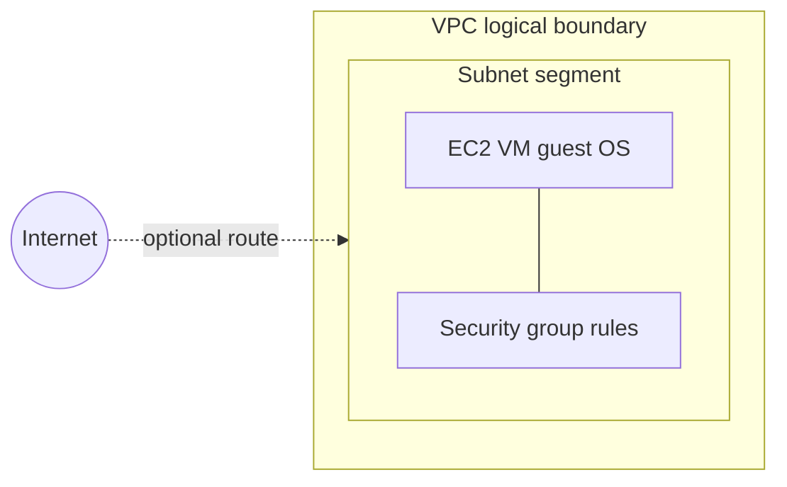

<div class="eli5">
<span class="label">ELI5</span>
<p>ServiceNow already knows <em>what exists</em> in <strong>Amazon Web Services (AWS)</strong>
(the cloud provider) — your virtual machine and networks. <strong>Common Service Data Model
(CSDM)</strong> is the agreed way to add <em>what it is for</em> — for example “Payments (lab)”
— and link that story to real <strong>configuration items (CIs)</strong> in the
<strong>Configuration Management Database (CMDB)</strong>. ServiceNow stores
<strong>descriptions and relationships</strong>; it does not host your app or your data.</p>
</div>

<nav class="toc" aria-label="Lab 7 contents">
  <div>
    <p class="toc-title">On this page</p>
    <ul class="toc-list">
      <li><a href="#hands-on-lab"><strong>Jump to Hands-On Lab →</strong></a></li>
    </ul>
  </div>
  <div>
    <p class="toc-title">Pre-Lab: understand the concepts</p>
    <ul class="toc-list">
      <li><a href="#pre-lab">How to use this page</a></li>
      <li><a href="#pre-lab-cloud">Cloud and AWS</a></li>
      <li><a href="#pre-lab-vpc">VPC and networking</a></li>
      <li><a href="#pre-lab-storage">Compute, disk, databases</a></li>
      <li><a href="#pre-lab-template">Our lab stack (template)</a></li>
      <li><a href="#pre-lab-csdm">What CSDM adds</a></li>
      <li><a href="#pre-lab-maturity">What is automatic vs manual</a></li>
    </ul>
  </div>
  <div>
    <p class="toc-title">Hands-On Lab</p>
    <ul class="toc-list">
      <li><a href="#hands-on-lab">Wizard overview</a></li>
      <li><a href="#hands-on-wizard-vs-classic">Wizard vs classic form</a></li>
      <li><a href="#hands-on-step-1">Step 1 — List and New</a></li>
      <li><a href="#hands-on-wizard-basics">Wizard Basic Details</a></li>
      <li><a href="#hands-on-step-2">Step 2 — Classic form labels</a></li>
      <li><a href="#hands-on-step-3">Step 3 — Choose a Method</a></li>
      <li><a href="#hands-on-step-4">Step 4 — Preview</a></li>
      <li><a href="#hands-on-optional">Optional — script link</a></li>
      <li><a href="#hands-on-map">Optional — view map</a></li>
      <li><a href="#hands-on-checkpoint">Checkpoint</a></li>
    </ul>
  </div>
  <div class="toc-wide">
    <p class="toc-title">Reference</p>
    <ul class="toc-list">
      <li><a href="#glossary">Glossary (acronyms)</a></li>
      <li><a href="#sources">Sources</a></li>
      <li><a href="#whats-next">What is next (Lab 8)</a></li>
    </ul>
  </div>
</nav>

## Pre-Lab: Understand the concepts
{: #pre-lab}

Use this half **before** you click in ServiceNow. The [Hands-On Lab](#hands-on-lab) is numbered
and separate below.

**Prerequisites:** [Labs 4–6]({{ '/labs/04-run-import/' | relative_url }}) — at least one virtual machine
**configuration item (CI)** on table `cmdb_ci_vm_instance` named `sgclab-app-01`, **virtual private cloud (VPC)** network rows on
`cmdb_ci_network`, subnets and security groups imported. The graph still has **partial** network-interface
and storage edges ([Lab 4]({{ '/labs/04-run-import/' | relative_url }})). Earlier labs used
**Identification and Reconciliation Engine (IRE)** to match inserts/updates and
**Extract, Transform, Load (ETL)** mappings ([Labs 5–6]({{ '/labs/05-ire/' | relative_url }})).

---

### Cloud and Amazon Web Services (AWS)
{: #pre-lab-cloud}

**Amazon Web Services (AWS)** is a provider that runs physical datacenters and sells **access** to
resources in those buildings: virtual computers, networks, storage, databases, and hundreds of
other products. You create an **account**, pay for what you use (often metered by the hour or per
gigabyte), and call **application programming interfaces (APIs)** or a **web console** to create and
change resources. You do **not** own the physical server under your virtual machine.

Companies use AWS (or similar providers) versus **only their own datacenter**, versus
**software as a service (SaaS)** (someone else runs the whole application), for different mixes of:

| Factor | Why it comes up |
|---|---|
| **Elasticity** | Scale up for a sale, scale down overnight — no purchase order for new hardware |
| **Speed** | New environment in minutes instead of weeks of procurement |
| **Skills** | Team already knows AWS, or wants managed services (databases, load balancing) |
| **Data residency / regulation** | Banks and governments pick **regions**, encryption, and hybrid models (some systems stay on-premises) |
| **Operations** | Provider runs building power and the **hypervisor** (software that runs virtual machines); **you** still patch the **guest operating system** and secure the app — **shared responsibility** |
| **Cost** | Cloud is **not** automatically cheaper; idle or oversized resources still bill; stopped **Elastic Compute Cloud (EC2)** instances can still incur **Elastic Block Store (EBS)** disk charges |

**Illustrative patterns (not claims about any named company):**

- **Small product company:** one virtual web server + managed database, one **virtual private cloud
  (VPC)** network, autoscaling later.
- **Bank or regulated enterprise:** hybrid — legacy cores on-premises, cloud for specific workloads,
  heavy identity, logging, and change control; ServiceNow often tracks **what** exists and **what
  depends on what**, not **moves** workloads into ServiceNow.
- **Global technology firm:** many regions, load balancers, autoscaling groups, separate accounts per
  environment — **Configuration Management Database (CMDB)** and **Common Service Data Model (CSDM)**
  help **impact** and **ownership**, not replace architecture reviews.

None of these are “our lab.” The lab is one **stopped** small virtual machine for learning.

---

### Your “private network in AWS” (VPC)
{: #pre-lab-vpc}

A **virtual private cloud (VPC)** is a **logical**, account-local network boundary: address ranges
and routing rules AWS applies inside its fabric. It is **not** extra physical cabling to your office
and **not** automatic secrecy from the **internet**.

| Term | Beginner meaning |
|---|---|
| **VPC** | A private **Internet Protocol (IP)** address plan for your account in one **region** (here: e.g. `us-east-2`). Addresses often use **Classless Inter-Domain Routing (CIDR)** notation like `10.42.0.0/16`. In **this** lab’s CMDB, VPCs appear under table `cmdb_ci_network`, not necessarily `cmdb_ci_vpc`. |
| **Subnet** | A **segment** of that address plan tied to one **availability zone (AZ)** (one datacenter slice in the region). Lab CMDB: table `cmdb_ci_cloud_subnet`. |
| **Route table** | Rules that decide whether traffic can leave the subnet toward the internet or other networks. |
| **Security group** | **Stateful** virtual firewall attached to an instance’s **network interface** (allow/deny ports and sources). Not antivirus. Lab CMDB: table `cmdb_ci_compute_security_group`. |
| **Private IP** | Address used **inside** the VPC. |
| **Public IP** | Optional address reachable from the public internet if routing and firewall allow. **Public subnet** only means “this subnet *can* get a public path” — not every server is public. |
| **Remote login** | **Secure Shell (SSH)** for Linux or **Remote Desktop Protocol (RDP)** for Windows is a session **inside the guest operating system**, separate from the AWS console. Requires a **running** instance, reachable network path, credentials, and (for SSH) usually a key pair. **AWS Systems Manager (SSM)** **Session Manager** is another path — needs agent, **Identity and Access Management (IAM)** permissions, and endpoints; **not assumed** in this lab. |



In the diagram, **EC2** means **Elastic Compute Cloud** — AWS’s rented virtual computer.

**Do not** start the lab instance “to try SSH” unless you accept **cost and security** changes
(extra keys, inbound rules, or public IP). The template is built for **inventory learning**, not
remote administration.

---

### Compute, disk, files, databases — different jobs
{: #pre-lab-storage}

| AWS idea | What it is | In our lab stack? | Typical company use |
|---|---|---|---|
| **EC2** (**Elastic Compute Cloud**) | Rent a virtual computer (guest **operating system**) | **Yes** — one `t3.micro` size | Run app runtimes, batch jobs, middleware |
| **EBS** (**Elastic Block Store**) | Persistent **disk volume** attached to EC2 | **Implicit** with the instance (root volume); connector may show **partial** storage CIs | Keep data when the virtual machine restarts |
| **S3** (**Simple Storage Service**) | **Object** store (files/buckets) | **Not** in our minimal template | Backups, static assets, data lakes |
| **RDS** (**Relational Database Service**) | Managed **database** (provider patches engine) | **Not** in our template | Production apps without running MySQL on EC2 yourself |

ServiceNow imports **descriptions** of these through the **Service Graph Connector** and **AWS
Config** (configuration recorder); it does **not** store application data or run your **Payments**
code.

---

### Exactly what Lab 1 created (template truth)
{: #pre-lab-template}

From [`aws/lab-stack.yaml`](https://github.com/eltonaguiar/ServiceNow_ServiceGraph_Lab/blob/main/aws/lab-stack.yaml) in this repository (**AWS CloudFormation** = infrastructure as code template):

| Resource | Template fact | CMDB relevance |
|---|---|---|
| **VPC** | `10.42.0.0/16`, named `sgclab-vpc` | Table **`cmdb_ci_network`** after import |
| **Subnet** | `10.42.1.0/24`, **no** auto public **IP** | Table **`cmdb_ci_cloud_subnet`** |
| **Security group** | **No inbound rules** | Table **`cmdb_ci_compute_security_group`** |
| **EC2** | **`t3.micro`**, image **Amazon Linux 2023** (**Amazon Machine Image (AMI)** from **AWS Systems Manager (SSM)** public parameter), **Name** tag `sgclab-app-01` | Table **`cmdb_ci_vm_instance`**, state **Off** when stopped |
| **Key pair / SSH** | **Not** defined in template | You cannot assume SSH works without **your** changes |
| **Tags** | `Environment`, `Owner`, `Application` (value `payments`) | Surface on CI or related attributes via connector — **not** the same as a CMDB column named `Application` |

**AWS Config** (Lab 3) was narrowed to **four** resource types: Instance, VPC, Subnet,
SecurityGroup. That matches **partial** network-interface/volume graph gaps in Labs 4–5 — do **not**
widen Config just to “finish” the graph for this course.

**There is no real Payments application installed** — only a label for learning.

---

### What CSDM adds (and what it does not prove)
{: #pre-lab-csdm}

**Common Service Data Model (CSDM)** is ServiceNow’s standard **tables and relationship types** for
linking technical **configuration items (CIs)** to **services** (things the business cares about).

| CSDM helps with | It does **not** automatically prove |
|---|---|
| “What technical items sit under this service?” | That the service would **fail** in production if one VM stops |
| Impact and change scoping questions | That every dependency is discovered |
| Shared vocabulary for Incident, Change, and architecture modules | That **Service Mapping** ran (licence + setup) |

**ServiceNow** holds **metadata**: classes, attributes, relationships, owners. **AWS** still runs
the VM. **This lab** does not move workloads into ServiceNow.

---

### What is automatic vs manual (maturity)
{: #pre-lab-maturity}

| Layer | Who fills it in this lab |
|---|---|
| EC2, VPC, subnet, security group | **Service Graph Connector** + **IRE** ([Labs 2–6]({{ '/labs/04-run-import/' | relative_url }})) |
| “This grouping is **Payments (lab)**” | **Human** ([Hands-On Lab](#hands-on-lab)) |
| Full automated dependency map | **Service Mapping** (optional product; **not** required here) |

---

## Hands-On Lab
{: #hands-on-lab}

**Goal:** Start an **application service** record in ServiceNow’s official wizard and use the
**Manual** population method toward your lab virtual machine — **without** claiming a finished
production graph.

**You need:** A **Personal Developer Instance (PDI)** (or similar) with CMDB data from Labs 4–6.
Confirm role **`app_service_admin`** (application service administrator) per ServiceNow docs —
entitlements vary by instance.

**Official references (field names differ by release):**

- [Create a Service instance (application service)](https://www.servicenow.com/docs/r/servicenow-platform/configuration-management-database-cmdb/create-it-services.html)
- [Manual population method](https://www.servicenow.com/docs/r/zurich/servicenow-platform/configuration-management-database-cmdb/populate-app-service-manual.html)
- [Amazon VPC overview](https://docs.aws.amazon.com/vpc/latest/userguide/what-is-amazon-vpc.html) (AWS)

Use ServiceNow’s documented flow — do **not** invent a second “service instance” child record
under the application service. The application service on table **`cmdb_ci_service_auto`** **is** the
service instance record for this workflow. Manual population stores the record under a subclass such
as **`cmdb_ci_service_discovered`** on many releases — that is **not** proof that **Service Mapping**
ran or that dependencies are complete.

### Wizard vs classic form (read first)
{: #hands-on-wizard-vs-classic}

ServiceNow documents an **Application Service wizard** with three stages —
**Provide Basic Details** → **Populate the Application Service** → **Preview the Service** ([Create a Service instance](https://www.servicenow.com/docs/r/servicenow-platform/configuration-management-database-cmdb/create-it-services.html)).
Community guidance describes that wizard as a separate UI (often referenced in URLs containing
`csdm_app_service`) from the **classic Service Instance form** on `cmdb_ci_service_auto` — field
labels differ between them.

| You are in the **wizard** if… | You are in the **classic form** if… |
|---|---|
| Title such as **Create an Application Service** / **New Application Service** | One scrolling form (often **Service Instance** header) |
| Stages **Provide Basic Details** → **Populate the Application Service** → **Preview the Service** | No population stage — **Submit** / **Save** on one form |
| Basic Details field label **Environment** (distinct from **Used for**) | **Used for**, **Comments**, **Business criticality**, **Service classification** |
| **Next** moves toward population / **Choose a Method** | List **New** may be a single button with **no** dropdown (observed on one classic path) |

**Do not conflate labels:** On the wizard, **Environment** is its own field (one PDI showed default
**None**). On the classic form, **Used for** = `Development` is a **different** label — do **not** type
`Development` into **Environment** on the wizard unless that field’s choice list offers it, and do
**not** rename wizard **Environment** to **Used for** in your notes.

**Navigator search:** Typing **service instance** can show **more than one** module, for example:

- **Configuration** → **Service Instances** → **Service Instances**
- **CSDM** → **Manage Technology Manage…** (label may truncate in search) → **Service Instance**

This lab does **not** assert which of those entries opened the wizard vs the classic form until **you**
confirm which path you used. The official written procedure uses the **CSDM** branch ([Create a Service instance](https://www.servicenow.com/docs/r/servicenow-platform/configuration-management-database-cmdb/create-it-services.html)); your instance may also expose **Configuration** lists. Filter Navigator jumps straight to `cmdb_ci_service_auto.list` can still open the **classic** form on some PDIs.

Role **`app_service_admin`** is required for manual population ([manual populate doc](https://www.servicenow.com/docs/r/zurich/servicenow-platform/configuration-management-database-cmdb/populate-app-service-manual.html)); without it you may see a reduced UI. This lab does **not** invent direct URLs or deep links.

### Step 1 — Open the wizard or classic list
{: #hands-on-step-1}

1. Use **Navigator search** or menus to open a **Service Instances** list (see dual entries above).
   Note which path you chose so you can compare wizard vs classic behavior.
2. On the list, click **New** (on one classic path this was a **lone** button with **no** menu dropdown).
3. **If the Application Service wizard opens**, you should see:
   - Title **Create an Application Service** or **New Application Service** (wording varies by release)
   - Stages **Provide Basic Details** → **Populate the Application Service** → **Preview the Service**

**If you get the classic form instead:**

1. **Do not Submit** yet — note field labels (**Used for**, not **Environment**).
2. Try the **other** Service Instances module from Navigator search, then **New** again.
3. Confirm **`app_service_admin`**. Entitlements change available **New** actions.

**Neither route submitted yet?** That is fine for learning — this lab does not require a saved record to
read the pre-lab material. For instructor review, capture the **full list** (title + **New** control) and
note which navigator entry you used. We do **not** embed screenshots on the site.

### Step 1b — When you have the wizard (Basic Details)
{: #hands-on-wizard-basics}

On **Provide Basic Details**, match **wizard** labels only (verified on one PDI — defaults may differ):

| Wizard field (on screen) | What to enter for this lab |
|---|---|
| **Number** | Leave auto-generated |
| **Name** | `Payments (lab)` |
| **Environment** | Choose **Development** **if** it appears in the list (default observed: **None** — change only when offered) |
| **Operational status** | Keep **Non-Operational** for a learning record |
| Other fields on the same tab | Scroll and review; fill only what your instance marks required |

Then select **Next** toward **Populate the Application Service**. Do **not** claim **Done** or a saved
graph until you finish population and save.

### Step 2 — Classic form only (if you are not in the wizard)
{: #hands-on-step-2}

Learning example only — **not** production Payments. **Do not** claim the record is submitted or the
graph complete until you save and can verify relationships yourself.

**Wizard** — use Step 1b when you are on **Create an Application Service**; the on-screen label is
**Environment**, not **Used for** ([Create a Service instance](https://www.servicenow.com/docs/r/servicenow-platform/configuration-management-database-cmdb/create-it-services.html)).

**Classic Service Instance form** — separate route; labels observed when **New** opened the classic UI
(textual evidence only; not submitted on that path in this investigation):

| Classic field label | Example for this lab |
|---|---|
| **Name** | `Payments (lab)` |
| **Used for** | `Development` |
| **Business criticality** | `4 - not critical` (or your instance’s wording) |
| **Operational status** | `Non-Operational` |
| **Service classification** | `Application Service` |
| **Comments** | `learning example` |

**Environment** (wizard) and **Used for** (classic) are **different fields on different screens** — not
two names for the same wizard control. Match the **labels on your current screen**.

Set **relationships** only as your release requires. CSDM relationship names are **typed** — e.g.
**Depends on** / **Used by** in manual population docs. Do **not** treat **Hosted on** and **Runs
on** as interchangeable without checking **CI Relationship Types**. Creating relationships on the
form does **not** by itself prove **Service Mapping** or full service-map population.

**Expected:** You can advance to **Populate** (wizard) or save a draft classic record without
claiming the lab checkpoint is done.

### Step 3 — Populate the Application Service (Choose a Method)
{: #hands-on-step-3}

On **Populate the Application Service**, open **Choose a Method** (or **Next** to that modal). You
have **not** chosen a method yet until you pick one from **Service Population Method** and continue.

A **configuration item (CI)** is one tracked thing in the **Configuration Management Database (CMDB)**
(for example your lab virtual machine). Population methods decide **which CIs become members** of the
application service — not whether a real **Payments** application is installed in AWS.

#### Service population methods (this wizard screen)

Wording below matches the **Choose a Method** modal on one PDI (November 2026) plus
[Create a Service instance](https://www.servicenow.com/docs/r/servicenow-platform/configuration-management-database-cmdb/create-it-services.html).
**Roles** come from that page; your instance may differ.

| Method (UI label) | What it means in everyday terms | Prerequisites / notes (product + screenshot) |
|---|---|---|
| **Top-Down Discovery** | Let **Service Mapping** walk connections from an entry point and build the map. | UI: “Use CI connections to map the application service.” Requires **Service Mapping**, role **`service_mapping_admin`**, and a **leaf** domain. Doc role: **`sm_admin`**. Not this lab’s minimum path. |
| **Dynamic CI Groups** | Fill the service from an existing **CMDB group** (a saved group of CIs). | UI: “Use CMDB groups to populate the application service.” Doc: [Dynamic CI Group](https://www.servicenow.com/docs/r/servicenow-platform/configuration-management-database-cmdb/create-it-services.html) method. Role **`app_service_admin`**. You must already maintain CMDB groups — not required for our one-VM lab. |
| **Tags** | Populate from tag lists or tag families on CIs. | UI: requires **Service Mapping** and **`service_mapping_admin`**. Doc role: **`sm_admin`**. Lab AWS **tags** are not the same as picking this wizard method (see tag note below). |
| **Manual** | You pick specific CIs (for example `sgclab-app-01`) by class and name. | UI: “Manually select CIs to create a service.” Doc: [Manual method](https://www.servicenow.com/docs/r/zurich/servicenow-platform/configuration-management-database-cmdb/populate-app-service-manual.html). Role **`app_service_admin`**. **Simplest for this lab** — no Service Mapping entitlement required. |
| **Dynamic Service** | Service membership **updates when CI relationships change** (per wizard text). | UI: “Create App Service and dynamically update based on CI relationship changes.” Doc lists a separate **Dynamic Service** population method ([Create a Service instance](https://www.servicenow.com/docs/r/servicenow-platform/configuration-management-database-cmdb/create-it-services.html)); role **`app_service_admin`**. **Not** the same as **Dynamic CI Groups** (groups vs relationship-driven updates). This lab does **not** configure Dynamic Service rules. |

**Dynamic CI Groups vs Dynamic Service (short distinction):** **Dynamic CI Groups** attach the service
to a **CMDB group** membership set. **Dynamic Service** (product + UI) is a **relationship-driven**
population style — exact rules are product-defined; we only document what the wizard states, not
custom mechanics.


*Screenshot: wizard progress on **Populate the Application Service**; dropdown shows the first methods
(through **Manual**). No account identifiers visible — crop reviewed before commit.*


*Screenshot: same modal scrolled — **Manual** and **Dynamic Service** descriptions. UI options are
grounded in these captures.*

#### Step 3b — Select **Manual** (lab minimum)

1. In **Service Population Method**, select **Manual** (you may keep the default **-- Select one --**
   until you are ready — nothing is committed until you continue and save).
2. Confirm or fill the fields the wizard shows next for Manual (per [Manual method](https://www.servicenow.com/docs/r/zurich/servicenow-platform/configuration-management-database-cmdb/populate-app-service-manual.html)), typically including:
   - **Class** — choose the CI class (here: virtual machine / **`cmdb_ci_vm_instance`**).
   - **CI** — pick **`sgclab-app-01`** (avoid `*` searches on large estates).
3. **Expected:** The record uses a class extending **`cmdb_ci_service_auto`** (often
   **`cmdb_ci_service_discovered`** for manual creation on many releases). Saving may still be required
   before **Preview** or **View Map** shows members.

**Tag note:** AWS tag `Application=payments` is **cloud metadata**. It is **not** automatically a
filter field named `Application` on `cmdb_ci_vm_instance`. The wizard **Tags** population method
requires **Service Mapping** — **not** this minimum path.

**Expected:** Manual selection plus CI pick — **not** proof of a complete service map, **Service Mapping**
run, or a production **Payments** workload.

### Step 4 — Preview
{: #hands-on-step-4}

1. Open the **Preview** tab.

**Expected:** The tab may show **little or nothing** until population is finished and saved. A blank
preview is **not** proof you failed — only that there is nothing to review yet. **Do not** claim a
complete service map until you can open **View Map** (or equivalent) on a **saved** record.

**What you are not proving:**

- No running **Payments** workload.
- No full dependency graph (network-interface/storage partials remain).
- No automatic business outage simulation.

### Optional — Link a CI with a script (advanced)
{: #hands-on-optional}

On your own PDI only, [`scripts/link_ci.py`](https://github.com/eltonaguiar/ServiceNow_ServiceGraph_Lab/blob/main/scripts/link_ci.py) can create relationships. The **parent** must be the
**application service** you created (`cmdb_ci_service_auto` or discovered subclass), **not** table
`cmdb_ci_service_instance` as a separate child.

```bash
python3 scripts/link_ci.py --list-types
```

Pick a relationship type your instance allows for **Manual** population — align with CSDM, not
assumed **Hosted on** labels.

### Optional — View the map
{: #hands-on-map}

After **Done**, open **View Map** or **Dependency Views** if your release offers them.

**Expected:** The drawing shows **relationships you created**, not completeness. Missing subnets or
partial storage edges from Labs 4–5 can still leave the picture messier than production reality.

---

### Hands-On checkpoint
{: #hands-on-checkpoint}

<ul class="check">
<li>You can explain <b>VPC</b> vs subnet vs security group without calling the VPC “physical private cabling”</li>
<li>You know our VM is <b>Amazon Linux 2023</b>, <b>stopped</b>, and the template does <b>not</b> promise <b>SSH</b></li>
<li>You opened the <b>wizard or classic Service Instance form</b> via the documented module path and entered <code>Payments (lab)</code> with learning intent (classic: <b>Used for</b> = Development, <b>Comments</b> = learning example — wizard: <b>Environment</b> per docs)</li>
<li>You have <b>not</b> claimed the record is saved, submitted, or fully populated</li>
<li>You used <b>Manual</b> population toward <code>cmdb_ci_vm_instance</code> / <code>sgclab-app-01</code></li>
<li>You do <b>not</b> claim a finished production Payments stack or complete dependency graph</li>
</ul>

---

## Glossary (acronyms used on this page)
{: #glossary}

| Acronym | Stands for | One-line meaning on this page |
|---|---|---|
| **AMI** | Amazon Machine Image | Template for the virtual machine’s disk and operating system |
| **API** | Application programming interface | Programmatic way to create or change AWS resources |
| **AWS** | Amazon Web Services | Cloud provider whose resources this lab imports |
| **AZ** | Availability zone | Isolated datacenter slice within an AWS region |
| **CI** | Configuration item | One tracked thing in the CMDB (for example a VM or VPC) |
| **CIDR** | Classless Inter-Domain Routing | How IP address ranges are written (e.g. `10.42.0.0/16`) |
| **CMDB** | Configuration Management Database | ServiceNow database of CIs and relationships |
| **CSDM** | Common Service Data Model | ServiceNow standard for services linked to CIs |
| **EBS** | Elastic Block Store | Disk volume attached to an EC2 instance |
| **EC2** | Elastic Compute Cloud | AWS virtual server product |
| **ETL** | Extract, Transform, Load | Connector step that maps AWS fields to CMDB columns ([Lab 6]({{ '/labs/06-etl-mappings/' | relative_url }})) |
| **IAM** | Identity and Access Management | AWS who-is-allowed-to-do-what (APIs and console) |
| **IP** | Internet Protocol | Numeric addressing for network traffic |
| **IRE** | Identification and Reconciliation Engine | ServiceNow engine that matches incoming CIs and avoids duplicates ([Lab 5]({{ '/labs/05-ire/' | relative_url }})) |
| **PDI** | Personal Developer Instance | Free or personal ServiceNow sandbox for learning |
| **RDS** | Relational Database Service | AWS managed database service |
| **RDP** | Remote Desktop Protocol | Windows remote desktop session |
| **S3** | Simple Storage Service | AWS object/file bucket storage |
| **SaaS** | Software as a service | Vendor runs the full application for you |
| **SSH** | Secure Shell | Encrypted remote command line, common on Linux |
| **SSM** | AWS Systems Manager | AWS operations suite (here: AMI parameter and optional Session Manager) |
| **VPC** | Virtual Private Cloud | Logical private network inside your AWS account |

Literal table names (`cmdb_ci_*`), list names, AWS resource IDs, and shell commands are unchanged
from product definitions — expand acronyms in the prose beside them.

---

## Sources used for this page
{: #sources}

| Topic | URL |
|---|---|
| Create application service / wizard | https://www.servicenow.com/docs/r/servicenow-platform/configuration-management-database-cmdb/create-it-services.html |
| Manual population | https://www.servicenow.com/docs/r/zurich/servicenow-platform/configuration-management-database-cmdb/populate-app-service-manual.html |
| Amazon VPC overview | https://docs.aws.amazon.com/vpc/latest/userguide/what-is-amazon-vpc.html |
| Lab inventory template | https://github.com/eltonaguiar/ServiceNow_ServiceGraph_Lab/blob/main/aws/lab-stack.yaml |

---

## What is next
{: #whats-next}

Lab 8 (optional in the full curriculum) adds a **second cloud source** and reconciliation — only
after one service model makes sense on paper.

Next: [Lab 8 — multisource CMDB with Azure]({{ '/labs/08-multisource-azure/' | relative_url }}) (optional track)
